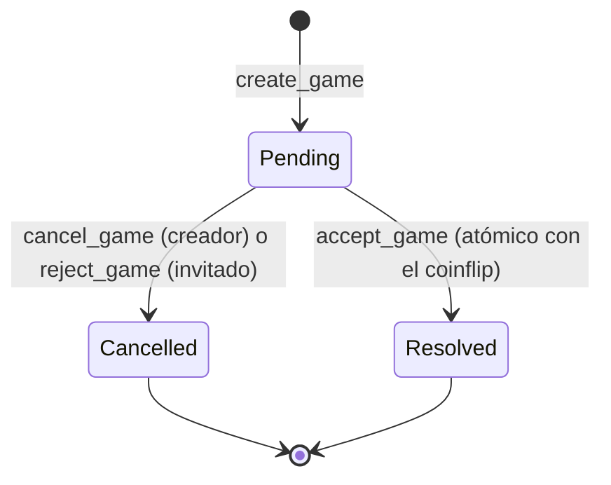

# contracts/ — paquete Move `battleship`

Referencia del contrato on-chain para quien lo consume sin leer el código Move: Game (#5, #6), la capa
`app/src/sui/` (#9, #11) y el panel admin (#14). Fuente canónica: `sources/*.move`; si esta tabla y el
código discrepan, manda el código y se corrige la tabla en el mismo PR (`agents.md` §5).

| Ruta | Contenido |
|---|---|
| `sources/house.move` | `battleship::house` |
| `sources/game.move` | `battleship::game` |
| `tests/house_tests.move` | Suite de `battleship::house` (`sui::test_scenario`) |
| `tests/game_tests.move` | Suite de `battleship::game` (`sui::test_scenario`) |

**Gates (build, lint, test, coverage):** forma canónica en `agents.md` §3 (desde `contracts/`, con
`-e testnet` y `printf 'n\n' |` delante). Baselines vigentes en `documents/STATUS.md`.

## `battleship::house`

Una única `House` compartida guarda la comisión, los límites de apuesta y las comisiones cobradas. La
administra quien posee el `HouseCap`.

### Objetos

| Struct | Habilidades | Campos | Nota |
|---|---|---|---|
| `House` | `key` (compartido) | `id: UID`, `version: u64`, `fee_rate: u16`, `fees_collected: Balance<SUI>`, `min_bet: u64`, `max_bet: u64` | Invariantes: `fee_rate <= 1000`, `0 < min_bet <= max_bet` |
| `HouseCap` | `key` (sin `store`) | `id: UID` | Capability de admin |
| `HOUSE` | `drop` | — | One-time witness (crea el `Publisher`) |

Valores con los que nace la House (constantes del módulo):

| Constante | Valor | Significado |
|---|---|---|
| `VERSION` | `1` | Versión del paquete que puede leer la configuración y escribir la House |
| `MAX_FEE_BPS` | `1000` | Comisión máxima (10 %) |
| `DEFAULT_FEE_BPS` | `0` | Comisión inicial (ver "Fee por defecto 0") |
| `DEFAULT_MIN_BET` | `1_000_000` MIST | 0,001 SUI |
| `DEFAULT_MAX_BET` | `50_000_000_000` MIST | 50 SUI |

### Funciones

| Firma | Visibilidad | Quién puede llamar | Abort codes | Evento |
|---|---|---|---|---|
| `init(otw: HOUSE, ctx: &mut TxContext)` | privada | runtime, al publicar | — | — (comparte la `House`, envía el `HouseCap` y el `Publisher` al publicador) |
| `update_fee_rate(house: &mut House, _: &HouseCap, new_fee_rate: u16)` | `entry` | titular del `HouseCap` | `EWrongVersion` (3), `EFeeTooHigh` (0) | `FeeRateUpdated` |
| `update_bet_limits(house: &mut House, _: &HouseCap, min_bet: u64, max_bet: u64)` | `entry` | titular del `HouseCap` | `EWrongVersion` (3), `EInvalidBetLimits` (1) | `BetLimitsUpdated` |
| `transfer_house_cap(cap: HouseCap, recipient: address)` | `entry` | titular del `HouseCap` (por valor) | — | `HouseCapTransferred` |
| `migrate(house: &mut House, _: &HouseCap)` | `entry` | titular del `HouseCap` | `ENotUpgrade` (4) | `HouseMigrated` |
| `withdraw_fees(house: &mut House, _: &HouseCap, ctx: &mut TxContext): Coin<SUI>` | `public` | titular del `HouseCap` | `EWrongVersion` (3), `ENoFeesToWithdraw` (2) | `FeesWithdrawn` |
| `add_fees(house: &mut House, fees: Balance<SUI>)` | `public(package)` | solo módulos de `battleship` (`game::accept_game`, en el cobro) | `EWrongVersion` (3) | — (acepta valor 0) |
| `fee_rate(house: &House): u16` | `public` | cualquiera | `EWrongVersion` (3) | — |
| `fees_collected(house: &House): u64` | `public` | cualquiera | `EWrongVersion` (3) | — |
| `min_bet(house: &House): u64` | `public` | cualquiera | `EWrongVersion` (3) | — |
| `max_bet(house: &House): u64` | `public` | cualquiera | `EWrongVersion` (3) | — |
| `version(house: &House): u64` | `public` | cualquiera | — | — (lectura de diagnóstico **sin** chequeo de versión: el panel #14 la usa para detectar una House que no coincide con el paquete) |

En las funciones con `EWrongVersion`, el chequeo de versión va **antes** que cualquier otro: con una versión
que no coincide, el abort es siempre `EWrongVersion`, aunque otro argumento también sea inválido. Los montos
están en MIST y la comisión en basis points (1 bp = 0,01 %).

### Eventos

Todos `has copy, drop`; tipo completo `<packageId>::house::<Evento>`.

| Evento | Campos | Emite |
|---|---|---|
| `FeeRateUpdated` | `house_id: ID`, `old_fee_rate: u16`, `new_fee_rate: u16` | `update_fee_rate` |
| `BetLimitsUpdated` | `house_id: ID`, `old_min_bet: u64`, `old_max_bet: u64`, `new_min_bet: u64`, `new_max_bet: u64` | `update_bet_limits` |
| `FeesWithdrawn` | `house_id: ID`, `amount: u64` | `withdraw_fees` |
| `HouseCapTransferred` | `cap_id: ID`, `recipient: address` | `transfer_house_cap` |
| `HouseMigrated` | `house_id: ID`, `old_version: u64`, `new_version: u64` | `migrate` |

### Abort codes

Números estables (D-20261030-11 §5): un código publicado no cambia de número ni de significado. Base de
`app/src/sui/errors.ts` (#11).

| Código | Constante | Condición | Funciones |
|---|---|---|---|
| 0 | `EFeeTooHigh` | `new_fee_rate > MAX_FEE_BPS` (1000) | `update_fee_rate` |
| 1 | `EInvalidBetLimits` | `min_bet == 0` o `min_bet > max_bet` | `update_bet_limits` |
| 2 | `ENoFeesToWithdraw` | `fees_collected == 0` | `withdraw_fees` |
| 3 | `EWrongVersion` | `house.version != VERSION` | `update_fee_rate`, `update_bet_limits`, `withdraw_fees`, `add_fees`, `fee_rate`, `fees_collected`, `min_bet`, `max_bet` |
| 4 | `ENotUpgrade` | `migrate` con `house.version >= VERSION` | `migrate` |

### Autorización

- La authZ de admin es la **posesión del `HouseCap`**: no hay campo `admin` ni comparación con
  `ctx.sender()`. Quien tiene el cap lo pasa por referencia a la función.
- El cap se transfiere **solo** con `transfer_house_cap`, no con el "Send" de la wallet: no tiene `store`, así
  que `public_transfer` no aplica, y por eso tampoco se puede congelar, compartir, envolver ni vender.
- Traza del titular: el `HouseCap` sale de los efectos de la publicación (`init`) y cada cambio de manos
  emite `HouseCapTransferred`.
- En los tests, el caso denegado no se expresa con `expected_failure` (sin el cap la llamada no compila ni
  se arma como transacción): se cubre verificando la custodia del cap antes y después de transferirlo y que
  el nuevo titular administra.

### Qué pasa si se pierde el cap

Sin `HouseCap`, las comisiones quedan **bloqueadas** y la configuración **congelada para siempre**. El caso
probable es enviarlo a un **ID de objeto** (por ejemplo, el de la House) en vez de a una dirección: queda
huérfano, porque solo `house` podría recibirlo (`transfer::receive`) y no lo expone. Nota para #14: validar
el formato del destinatario (SEG-9) y que no sea un objeto existente antes de llamar a `transfer_house_cap`.

### Fee por defecto 0 (D-20261030-11)

La House nace con `fee_rate = 0`. Como el `Game` copia el fee al crearse (D-20261030-06 §3), las partidas
creadas antes del primer `update_fee_rate` quedan con comisión 0 para siempre.
**Paso obligatorio post-publicación (#8):** el owner llama `update_fee_rate` antes de anunciar el juego.

### Retiro de comisiones

`withdraw_fees` devuelve un `Coin<SUI>` (sin `drop`): la transacción decide el destino, y `sui client call`
sola falla por valor sin usar. Se usa en un PTB. Ejemplo (lo ejecuta el owner, nunca un agente):

```bash
sui client ptb --move-call <PKG>::house::withdraw_fees @<HOUSE_ID> @<CAP_ID> --assign fees --transfer-objects "[fees]" @<DESTINO>
```

El `Coin` vale exactamente `fees_collected` antes del retiro y la House queda en 0. Las comisiones solo
entran por `add_fees` y solo salen por `withdraw_fees`.

### Límites de apuesta

`min_bet`/`max_bet` solo se aplican al **crear** una partida (#5). Cambiarlos con `update_bet_limits` no
afecta a las partidas `Pending` existentes, y aceptar solo exige igualar el monto exacto del creador
(D-20261030-06 §1).

### Versionado (D-20261030-11 §7)

- Tras un upgrade, toda versión anterior del paquete sigue siendo invocable. La House guarda `version`, y las
  funciones que la escriben (`update_fee_rate`, `update_bet_limits`, `withdraw_fees`, `add_fees`) **y** los
  accessors `fee_rate`, `fees_collected`, `min_bet` y `max_bet` exigen `version == VERSION` (`EWrongVersion`,
  chequeado antes que cualquier otro argumento). `version()` no valida (diagnóstico).
- Tras un upgrade que sube `VERSION`, el titular del cap llama al `migrate` de la **versión nueva**. Desde ahí
  el código de las versiones viejas no puede escribir ni leer la configuración de la House, y el `migrate`
  de un paquete viejo aborta con `ENotUpgrade` (no se migra hacia atrás). En la v1, `migrate` siempre aborta:
  la House nace en `VERSION`.
- `transfer_house_cap` no recibe la House y queda fuera del versionado.

### Contención

`update_fee_rate`, `update_bet_limits`, `withdraw_fees`, `migrate` y `add_fees` (llamado por cada
`accept_game`) toman `&mut House`: las resoluciones de partidas se serializan sobre la House. Aceptable en
el MVP.

### ID de la House

El ID de la House (y el del `HouseCap`) sale de los efectos de la publicación y se registra en
`contracts/deployments/<red>.json` (#7). La app lo lee desde ahí (`agents.md` §5); el contrato no expone un
accessor de ID (dentro del paquete, `object::id(house)`).

## `battleship::game`

Cada partida es su **propio objeto compartido** `Game` (PROY-6): guarda la apuesta del creador como
`Balance<SUI>` (sin módulo Escrow, D-20261030-15 D4) hasta que la partida se cancela, se rechaza o se
resuelve. Crear, cancelar y rechazar llegaron en #5; aceptar con el coinflip (`accept_game`), en #6.

### Objetos

| Tipo | Habilidades | Campos / variantes | Nota |
|---|---|---|---|
| `Game` | `key` (compartido, sin `store`) | `id: UID`, `version: u64`, `house_id: ID`, `creator: address`, `opponent: Option<address>`, `bet: u64`, `stake: Balance<SUI>`, `fee_rate: u16`, `state: GameState` | Solo este módulo lo comparte; nadie lo transfiere, envuelve ni congela. Invariantes: `stake == bet` en `Pending`, `stake == 0` en `Cancelled`/`Resolved` (PROY-8); `bet` no cambia nunca |
| `GameState` | `copy, drop, store` (enum `public`) | `Pending`, `Cancelled`, `Resolved { acceptor: address, winner: address }` | Solo `game` lo construye o hace `match`. `Resolved` lo construye `accept_game` |

Significado de los campos de `Game`:

| Campo | Significado |
|---|---|
| `version` | Versión del paquete que creó la partida (`house.version()` al crear). Solo `accept_game` la compara; ningún camino de reembolso la lee (ver Versionado del `Game`) |
| `house_id` | House contra la que se liquida la partida; `accept_game` exige esta (`EWrongHouse`) |
| `opponent` | `none` = partida abierta; `some(a)` = invitación directa a `a` |
| `bet` | Apuesta en MIST, fija durante toda la vida del objeto |
| `stake` | Fondos custodiados: igual a `bet` mientras está `Pending`; 0 al terminar |
| `fee_rate` | Comisión en basis points copiada de la House al crear (D-20261030-06 §3); es la que cobra `accept_game` |

Sin campos de tiempo (D-20261030-15 D6): la hora de creación es la de la transacción que emitió `GameCreated` (el campo concreto depende de la API de lectura que elija #10).

### Estados

Sin estado `Active` y **sin expiración** (D-20261030-06 §1-§2): `accept_game` acepta y resuelve en la misma
transacción.



### Funciones

| Firma | Visibilidad | Quién puede llamar | Abort codes, **en este orden** | Evento |
|---|---|---|---|---|
| `create_game(house: &House, stake: Coin<SUI>, opponent: Option<address>, ctx: &mut TxContext)` | `entry` | cualquiera (no puede invitarse a sí mismo) | `house::EWrongVersion` (3, módulo `house`), `EBetTooLow` (0), `EBetTooHigh` (1), `ESelfInvite` (2) | `GameCreated` |
| `cancel_game(game: &mut Game, ctx: &mut TxContext)` | `entry` | solo `game.creator` | `ENotCreator` (3), `ENotPending` (4) | `GameCancelled` (`cancelled_by` = creador) |
| `reject_game(game: &mut Game, ctx: &mut TxContext)` | `entry` | solo la dirección de `game.opponent` | `ENoInvitation` (6), `ENotInvited` (5), `ENotPending` (4) | `GameCancelled` (`cancelled_by` = invitado) |
| `accept_game(game: &mut Game, house: &mut House, payment: Coin<SUI>, r: &Random, ctx: &mut TxContext)` | `entry` | cualquiera menos `game.creator`; en una invitación, solo la dirección de `game.opponent` | `EVersionMismatch` (7), `EWrongHouse` (8), `ESelfPlay` (9), `ENotInvited` (5), `ENotPending` (4), `EWrongStake` (10), `house::EWrongVersion` (3, módulo `house`, en el cobro) | `GameResolved` |
| `refund_creator(game: &mut Game, cancelled_by: address, ctx: &mut TxContext)` | privada | `cancel_game` y `reject_game` | — | `GameCancelled` |
| `is_pending(game: &Game): bool` | privada | `cancel_game`, `reject_game` y `accept_game` | — | — |
| `assert_acceptable(game: &Game, house: &House, payment: &Coin<SUI>, acceptor: address)` | privada | `accept_game` (antes del sorteo) | `EVersionMismatch` (7), `EWrongHouse` (8), `ESelfPlay` (9), `ENotInvited` (5), `ENotPending` (4), `EWrongStake` (10) | — |
| `collect_pot(game: &mut Game, house: &mut House, payment: Coin<SUI>): (Balance<SUI>, u64, u64)` | privada | `accept_game` (antes del sorteo) | `house::EWrongVersion` (3, en `house::add_fees`) | — (une las dos apuestas, envía la comisión a la House y devuelve `(pago, pozo, comisión)`) |
| `pay_winner(game: &mut Game, payout: Balance<SUI>, pot: u64, fee: u64, acceptor: address, winner_index: u64, ctx: &mut TxContext)` | privada | `accept_game` (después del sorteo) | — | `GameResolved` (marca `Resolved` y transfiere el pago al ganador) |
| `fee_amount(pot: u64, fee_rate: u16): u64` | privada | `collect_pot` | — | — (`⌊pot × fee_rate / 10_000⌋` con intermedio `u128`) |

- **Crear:** las lecturas de la House con chequeo de versión (`min_bet`, `max_bet`, `fee_rate`) van **primero**:
  con la House en otra versión el abort es siempre `house::EWrongVersion`, aunque la apuesta también sea
  inválida. Después, la apuesta (`EBetTooLow`, `EBetTooHigh`) y por último la autoinvitación (`ESelfInvite`).
  La apuesta es el valor **entero** del `Coin` recibido; los límites se comparan inclusive
  (`min_bet <= bet <= max_bet`).
- **Cancelar y rechazar:** **authZ antes que estado**. Un tercero recibe siempre `ENotCreator`/`ENotInvited`,
  aunque la partida ya no esté `Pending` (no aprende su estado: denegar por defecto). En rechazar, una partida
  abierta da `ENoInvitation` antes que cualquier otro chequeo.
- **Aceptar:** **versión y House primero**: si `game.version != house.version()` el abort es siempre
  `EVersionMismatch`, y después, si la House no es la de la partida, `EWrongHouse`. Luego **authZ antes que
  estado**: el creador recibe siempre `ESelfPlay` (también sobre su propia invitación) y un tercero sobre una
  invitación ajena `ENotInvited`, aunque la partida ya no esté `Pending`. Después el estado (`ENotPending`) y por
  último el monto: el `Coin` debe valer **exactamente** `bet` (`EWrongStake`, ni más ni menos). El **cobro de la
  comisión** (`house::add_fees`, que valida la versión de la House) va **antes del sorteo**; **tras el sorteo
  nada que dependa del resultado puede abortar** (los límites globales de la transacción y el gas afectan igual a
  ambos caminos).
- Las cuatro funciones son `entry` (no `public`, D-20261030-15 D8 y D-20261030-16 D5): no se componen desde
  otro paquete; se llaman desde transacciones (PTB). En `accept_game` es además obligatorio por recibir `Random`
  (ver Aleatoriedad).

### Eventos

Todos `has copy, drop`; tipo completo `<packageId>::game::<Evento>`.

| Evento | Campos | Emite |
|---|---|---|
| `GameCreated` | `game_id: ID`, `creator: address`, `opponent: Option<address>`, `bet: u64`, `fee_rate: u16` | `create_game` |
| `GameCancelled` | `game_id: ID`, `creator: address`, `cancelled_by: address`, `refund: u64` | `cancel_game` (`cancelled_by` = creador) y `reject_game` (`cancelled_by` = invitado) |
| `GameResolved` | `game_id: ID`, `creator: address`, `acceptor: address`, `winner: address`, `pot: u64`, `fee: u64`, `payout: u64` | `accept_game` (`pot == payout + fee`; `winner` es `creator` o `acceptor`) |

Aceptar emite un solo evento (D-20261030-16 D4): la aceptación y la resolución son la misma transacción. Las
listas de la app (partidas abiertas, mis partidas, invitaciones) salen de estos eventos (PROY-6); el estado
vigente de cada partida se lee del objeto.

### Abort codes

Números estables (D-20261030-11 §5): un código publicado no cambia de número ni de significado. Base de
`app/src/sui/errors.ts` (#11).

| Código | Constante | Condición | Funciones |
|---|---|---|---|
| 0 | `EBetTooLow` | valor del `stake` < `house.min_bet()` | `create_game` |
| 1 | `EBetTooHigh` | valor del `stake` > `house.max_bet()` | `create_game` |
| 2 | `ESelfInvite` | `opponent == some(sender)` | `create_game` |
| 3 | `ENotCreator` | `sender != game.creator` | `cancel_game` |
| 4 | `ENotPending` | estado de la partida distinto de `Pending` | `cancel_game`, `reject_game`, `accept_game` |
| 5 | `ENotInvited` | `game.opponent == some(a)` y `sender != a` | `reject_game`, `accept_game` |
| 6 | `ENoInvitation` | rechazo de una partida abierta (`opponent == none`) | `reject_game` |
| 7 | `EVersionMismatch` | `game.version != house.version()` | `accept_game` |
| 8 | `EWrongHouse` | `object::id(house) != game.house_id` | `accept_game` |
| 9 | `ESelfPlay` | `sender == game.creator` | `accept_game` |
| 10 | `EWrongStake` | valor del pago `!= game.bet` | `accept_game` |

`create_game` y `accept_game` también abortan con **`house::EWrongVersion` (3, del módulo `house`)**: en
`create_game`, en las lecturas de la House (el primer chequeo); en `accept_game`, en el cobro (`add_fees` dentro
de `collect_pot`), después de todos los chequeos propios y antes del sorteo (ver Versionado del `Game`). El
número 3 existe en los dos módulos con significados distintos (`house::EWrongVersion`, `game::ENotCreator`): #11
mapea los aborts por **módulo + código**, nunca solo por número.

### Autorización

- Sin capability: la authZ de partidas es la comparación de `ctx.sender()` con la dirección guardada (SEG-2).
  `create_game`: cualquiera, salvo invitarse a sí mismo. `cancel_game`: solo `game.creator`.
  `reject_game`: solo la dirección de `game.opponent`; el creador no puede rechazar su propia invitación
  (`ENotInvited`), pero sí cancelarla. `accept_game`: cualquiera salvo `game.creator` (`ESelfPlay`); en una
  invitación, solo la dirección de `game.opponent` (`ENotInvited`). Nadie juega contra sí mismo.
- Cada denegación tiene su test `expected_failure` en `tests/game_tests.move`.

### Flujo de fondos

- **Crear:** el `Coin<SUI>` entero pasa a `stake: Balance<SUI>` (`stake == bet`). No hay vuelto: el PTB
  separa antes el monto exacto.
- **Cancelar y rechazar:** `withdraw_all` del `stake` → un `Coin` por el total → **siempre a `game.creator`**
  (nunca al invitado). **100 %, sin comisión**; la House no se recibe ni se toca (`fees_collected` no cambia).
  La partida queda `Cancelled` con `stake == 0`.
- **Aceptar:** el `Coin` del aceptante (exactamente `bet`) se une al `stake` en un pozo de `2 × bet`. **Antes del
  sorteo**, la comisión (`fee`) entra a la House por `add_fees`; **después**, el ganador recibe un `Coin` por
  `payout = pot − fee`. Invariante: `payout + fee == 2 × bet`, `fees_collected` sube exactamente `fee`,
  `stake == 0` y estado `Resolved { acceptor, winner }`. Si la transacción aborta o el runtime la cancela,
  revierte entera: el aceptante conserva su `Coin` y la partida sigue `Pending`.
- Sin creación ni destrucción de valor; todo camino que recibe fondos tiene salida (cancelar, rechazar o
  aceptar). Conservación verificada en los tests (`Coin` de cada actor y `fees_collected` de la House, con ambos
  resultados del coinflip y varias partidas).

### Carreras

El consenso ordena las transacciones sobre el mismo `Game` compartido (el creador cancela o el invitado rechaza
mientras alguien acepta, o dos aceptantes a la vez). La primera gana; la segunda aborta con `ENotPending` (o con
su error de authZ, `ENotCreator`/`ENotInvited`/`ESelfPlay`, si además no está autorizada) y, al revertirse, no
pierde su `Coin`: una transacción abortada solo paga gas.

### Comisión

- El `fee_rate` de la House se **copia al crear** (D-20261030-06 §3): un `update_fee_rate` posterior no cambia
  las partidas existentes. Ver "Fee por defecto 0" en la sección House.
- **Fórmula:** `fee = ⌊pot × fee_rate / 10_000⌋` (`fee_rate` en basis points) con intermedio **`u128`**: con un
  `max_bet` alto, `pot × fee_rate` desborda `u64` (SEG-6).
- **Base:** el **pozo completo** (`2 × bet`, D-20261030-16 D3); el ganador recibe `pozo − comisión`.
- **Redondeo:** hacia abajo (D-20261030-16 D2): el resto de la división queda para el ganador y la House nunca
  cobra más que el porcentaje anunciado.
- `add_fees` se llama **siempre**, también con comisión 0 (por ejemplo, con el fee por defecto): su chequeo de
  versión aborta antes del sorteo, nunca después.
- Ejemplos: `bet` = 10 SUI con 250 bps → pozo 20 SUI, comisión 0,5 SUI, pago 19,5 SUI; `bet = 1_000_001` MIST con
  250 bps → pozo `2_000_002`, comisión `⌊50_000,05⌋ = 50_000`, pago `1_950_002`.

### Aleatoriedad (D-20261030-16 D6, SEG-5)

- `accept_game` es `entry` **no** `public`: otro paquete no puede componerla y abortar cuando pierde. El lint
  `public_random` del compilador marca toda función `public` que reciba `Random` o `RandomGenerator`, y con
  `--warnings-are-errors` corta el build.
- `Random` es el objeto compartido de sistema `0x8` y llega como `&Random`. El `RandomGenerator` se crea
  **dentro** de `accept_game` (`r.new_generator(ctx)`); nunca se recibe como parámetro.
- Sorteo **por índice, sin ramas**: `generate_u8_in_range(0, 1)` elige `[creador, aceptante][índice]`. Ambos
  resultados ejecutan el mismo cambio de estado, el mismo evento y la misma transferencia, así que gastan lo
  mismo: quien firma no puede elegir un presupuesto de gas que solo alcance para ganar.
- Orden: **validar → cobrar la comisión → sortear → pagar**. Todo lo que puede abortar va **antes** del sorteo;
  después, nada que dependa del resultado puede abortar (los límites globales de la transacción y el gas afectan
  igual a ambos caminos).
- Tests: helpers de test de `sui::random` (`create_for_testing` y `update_randomness_state_for_testing`, con
  sender `@0x0`), ambos resultados con el `Random` real y semillas fijas, y el reparto con el ganador forzado
  (`accept_with_winner_for_testing`, `#[test_only]`).

### Cancelaciones del runtime

Una transacción de `accept_game` puede no ejecutarse aunque el contrato no aborte:

- `ExecutionCancelledDueToRandomnessUnavailable`: la DKG de aleatoriedad de la época todavía no terminó (por
  ejemplo, recién arrancada la red o al cambiar de época).
- `ExecutionCancelledDueToSharedObjectCongestion`: demasiadas transacciones sobre un objeto compartido mutable (aquí,
  `&mut House`).

Ambas llegan como `effects.status = failure` con ese `kind` y **sin** `MoveAbort`
(`crates/sui-types/src/execution_status.rs:259, 270-271` @ `testnet-v1.83.0`); la partida y los fondos apostados
no cambian. #12 las muestra como "reintentar", nunca como éxito ni como error del contrato (SEG-10).

### Versionado del `Game` (D-20261030-15 DV)

- `version = house.version()` al crear; como las lecturas previas de la House ya validaron la versión, es
  igual a `house::VERSION` del paquete que crea.
- **Cancelar y rechazar no reciben la House ni leen la versión** (invariante D-20261030-12 §4): un reembolso
  nunca queda bloqueado por un upgrade; funcionan en cualquier versión.
- `accept_game` compara `game.version` con `house.version()` (`EVersionMismatch`, su primer chequeo) y cobra con
  `house::add_fees`, que exige que la House esté en el `VERSION` del código que se ejecuta. Tras un upgrade:
  1. **Partida vieja, código nuevo** (partida creada antes del `migrate`, House migrada) → `EVersionMismatch`
     (7): solo se cancela o rechaza, salvo que la versión nueva decida aceptarla.
  2. **House migrada, código viejo** (la misma partida vieja, llamada desde el paquete viejo) →
     `EVersionMismatch` (7): el chequeo de la partida va antes que el cobro.
  3. **Código viejo con partida nueva** (partida y House en la versión nueva, llamada desde el paquete viejo) →
     pasa los chequeos y aborta con `house::EWrongVersion` (3) en el cobro, antes del sorteo.
- Tras `migrate`, `create_game` del paquete viejo aborta con `house::EWrongVersion`.
- `GameState` y el layout de `Game` se **congelan en #8** (un upgrade compatible no agrega variantes al enum
  ni campos al struct): la batalla naval real (#18) necesitará un objeto nuevo o dynamic fields.

### Contención

`accept_game` toma `&mut House` (cobra la comisión): las aceptaciones de todas las partidas se serializan sobre
la House (aceptable en el MVP; ver Contención en la sección House). `Random` es un input compartido inmutable.

### Objeto terminal y storage (D-20261030-15 D3)

La partida terminada se **conserva** como objeto compartido (`Cancelled`/`Resolved`, `stake == 0`): no hay
función de borrado. Crearla deposita storage que **no se recupera**. Medido en el smoke de #6 (localnet, precio de
storage 76 y rebate 99,99 %, iguales a testnet): `storageRebate` del `Game` = **1953200 MIST** abierta, **2196400**
con invitación y **2439600** resuelta (≈ 0,0020–0,0024 SUI); la cancelada conserva el de su versión `Pending`. Al
aceptar, quien firma cobra el rebate de la versión `Pending` del objeto y paga el de la versión `Resolved`, así que
el depósito sigue inmovilizado en el objeto terminal. Es reversible en una versión futura con una función de borrado
**restringida al creador** (`sender == creator`), porque el rebate de storage va a quien firma la transacción que
borra. La UI (#11) muestra ese costo al crear.

### PTB

- **Crear:** `splitCoins(gas, [monto])` y `create_game(house, coin, opción)` con el `Coin` resultante;
  `opponent` es un `Option<address>` **puro** (`none` para una partida abierta, `some(dirección)` para una
  invitación). El builder vive en `app/src/sui/` (#11).
- **Cancelar / rechazar:** `cancel_game(game)` o `reject_game(game)` con el `Game` compartido; el reembolso
  llega al creador sin pasos extra en el PTB.
- **Aceptar:** `splitCoins(gas, [bet])` y `accept_game(game, house, coin, random)` con el `Coin` resultante; en
  TypeScript, el `Random` es `tx.object.random()` (objeto `0x8`). **Después del comando que usa `Random` solo se
  admiten `TransferObjects` o `MergeCoins`**: con cualquier otro, la transacción se rechaza antes de ejecutarse
  (`crates/sui-types/src/transaction.rs:1732-1760` @ `testnet-v1.83.0`). Los comandos previos, como el
  `splitCoins`, sí se permiten. El pago llega al ganador sin pasos extra. Desde la CLI:

  ```bash
  sui client ptb --split-coins gas "[<BET>]" --assign c --move-call <PKG>::game::accept_game @<GAME_ID> @<HOUSE_ID> c.0 @0x8
  ```

### Lectura desde la app

- La partida se lee del objeto con su contenido: todos los campos llegan por RPC aunque no haya getters Move (no
  hay accessors `public` a propósito, PROY-4; agregarlos después es compatible con upgrade).
- **API de lectura: la elige #10 (gRPC o GraphQL), D-20261031-01.** El fullnode de `sui 1.83.0` **no sirve
  JSON-RPC**: en el smoke de #6 todo `POST` al puerto RPC de la localnet devolvió `404` (H-1), y `sui-node` monta en
  ese puerto solo `sui_rpc_api::RpcService` (`crates/sui-node/src/lib.rs:2956-3054` @ `testnet-v1.83.0`). #10
  captura ahí las fixtures reales de cada variante (`Pending`, `Cancelled`, `Resolved`); #6 no crea
  `contracts/fixtures/`.
- **Referencia observada (no es el formato de la app):** `sui client object <id> --json` (CLI 1.83.0, smoke de #6)
  devuelve `objType`, `owner`, `prevTx`, `storageRebate` (número) y `content` **aplanado** (los campos del `Game`
  directamente, sin envoltorio). El enum llega como `{"@variant": "Pending"}`, `{"@variant": "Cancelled"}` y
  `{"@variant": "Resolved", "acceptor": "0x…", "winner": "0x…"}`; `u64` (`bet`, `version`) y `stake` (`Balance`,
  aplanado como su valor) como **string**; `u16` (`fee_rate`) como número con decimal (`250.0`); `opponent`
  (`Option<address>`) como `null` o la dirección. En el `parsedJson` de los eventos de la CLI, igual: `u16` como
  `250.0`, `Option` como `null` o la dirección. El formato exacto de gRPC/GraphQL lo fija #10 con fixtures.
- El parser de #10 usa **un** formato y trata una variante desconocida como error, nunca como `Pending` (SEG-10).
- El resultado de aceptar se lee del evento `GameResolved` de la transacción o del objeto
  (`Resolved { acceptor, winner }`).
- La hora de creación es el timestamp de la transacción del evento `GameCreated` (D-20261030-15 D6); el campo
  concreto depende de la API que elija #10.
