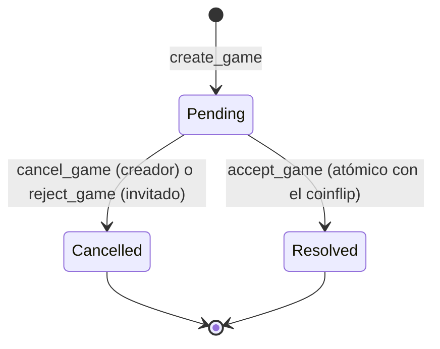

# contracts/ — paquete Move `battleship`

Referencia del contrato on-chain para quien lo consume sin leer el código Move: Game (#5, #6), la capa
`app/src/sui/` (#9, #11) y el panel admin (#14). Fuente canónica: `sources/*.move`; si esta tabla y el
código discrepan, manda el código y se corrige la tabla en el mismo PR (`agents.md` §5).

| Ruta | Contenido |
|---|---|
| `sources/house.move` | `battleship::house` |
| `sources/game.move` | `battleship::game` |
| `sources/duel.move` | `battleship::duel` (#73): base común de los juegos 1 vs 1 con reloj por jugada |
| `sources/coinflip.move` | `battleship::coinflip` (#73): el coinflip nuevo sobre `duel` |
| `tests/house_tests.move` | Suite de `battleship::house` (`sui::test_scenario`) |
| `tests/game_tests.move` | Suite de `battleship::game` (`sui::test_scenario`) |
| `tests/duel_tests.move`, `tests/coinflip_tests.move` | Suites de `battleship::duel` y `battleship::coinflip` (`sui::test_scenario`) |
| `scripts/publish.mjs` | Publicación con guardas, `record` y `check` de los despliegues (#7, ver "Despliegues") |
| `scripts/deployment.mjs` | Formato de `deployments/<red>.json`: funciones puras que usan el script y la CI |
| `scripts/*.test.mjs`, `scripts/fixtures/` | Tests (`node --test`) y salidas reales de la CLI 1.84.0 en una localnet desechable |
| `deployments/<red>.json`, `Published.toml` | Datos de cada publicación (testnet desde #8) |
| `fixtures/game-reads.localnet.json` | Lecturas gRPC reales de cada variante de `Game` y de sus eventos, capturadas en una localnet desechable con `app/scripts/capture-read-fixtures.mjs` (#10, ver "Lectura desde la app") |
| `fixtures/game-tx.localnet.json` | Transacciones reales de crear, cancelar, rechazar (#11) y aceptar (#12): éxitos (con cada ganador y sobre una invitación), dos fallos `MoveAbort` ejecutados y 11 `SimulationError` de simulaciones sin firmar, y el objeto House, capturados en una localnet desechable con `app/scripts/capture-tx-fixtures.mjs` (ver "Lectura desde la app") |
| `fixtures/house-admin.localnet.json` | Panel de la House (#14): listado real del `HouseCap` por tipo (`listOwnedObjects`), su `getObject`, 4 `SimulationError` de `house`/0, 1, 1, 2 y la preflight sin el cap, las transacciones de admin ejecutadas (`update_fee_rate`, `update_bet_limits`, `withdraw_fees` + `TransferObjects`) y la House después del retiro, capturados en una localnet desechable con `app/scripts/capture-house-fixtures.mjs` (ver "Lectura desde la app") |
| `fixtures/duel-reads.localnet.json` | Lecturas gRPC reales del coinflip nuevo (`Duel<Coinflip>`, #73): objetos `Pending`/`Cancelled`/`Resolved` (con cada ganador), sus eventos, la tabla de orígenes por lectura (`typeOrigins`), la publicación y el upgrade, y páginas crudas de `ListEvents` (un literal y la unión del coinflip anterior y el nuevo), capturadas **después** del upgrade con `app/scripts/capture-duel-reads.mjs` (ver "Fixtures de `duel`") |
| `fixtures/duel-tx.localnet.json` | Transacciones reales del coinflip nuevo (#73): crear, cancelar, rechazar y aceptar (ambos ganadores y una invitación), dos fallos `MoveAbort` ejecutados (`duel`/3 y `duel`/4), 11 `SimulationError` de simulaciones sin firmar, la House con las comisiones de las dos fuentes y las partidas anteriores (`game::Game`) aceptadas y canceladas después del upgrade desde el ID original y desde el del upgrade, capturadas con `app/scripts/capture-duel-tx.mjs` |
| `fixtures/duel-clock.localnet.json` | **SANDBOX** (`_meta.sandbox = true` y `_meta.sandboxConstants`): el reloj por jugada de `duel` con un juego de ensayo (`testgame`) de una v3 que NO está en el repo: objetos `Active`/`TimedOut`/`Expired`/`Resolved`, eventos `DuelActivated`/`DuelTurn`/`DuelTimedOut`/`DuelExpired`, la tabla de orígenes con IDs de definición de upgrades distintos, una página cruda con el literal prefijo (dos instanciaciones de `G`), 7 `SimulationError` y las transacciones de reclamar y reembolsar, capturados con `app/scripts/capture-duel-clock.mjs`. Sus tiempos (control 8 = 15 s, gracia de 15 s) **no** son los de producción |

**Gates (build, lint, test, coverage):** forma canónica en `agents.md` §3 (desde `contracts/`, con
`-e testnet` y `printf 'n\n' |` delante). Baselines vigentes en `documents/STATUS.md`.

## `battleship::house`

Una única `House` compartida guarda la comisión, los límites de apuesta y las comisiones cobradas. La
administra quien posee el `HouseCap`.

### Objetos

| Struct | Habilidades | Campos | Nota |
|---|---|---|---|
| `House` | `key` (compartido) | `id: UID`, `version: u64`, `fee_rate: u16`, `fees_collected: Balance<SUI>`, `min_bet: u64`, `max_bet: u64` | Invariantes: `fee_rate <= 1000`, `0 < min_bet <= max_bet` |
| `HouseCap` | `key` (sin `store`) | `id: UID` | Capability de admin |
| `HOUSE` | `drop` | — | One-time witness (crea el `Publisher`) |

Valores con los que nace la House (constantes del módulo):

| Constante | Valor | Significado |
|---|---|---|
| `VERSION` | `1` | Versión del paquete que puede leer la configuración y escribir la House |
| `MAX_FEE_BPS` | `1000` | Comisión máxima (10 %) |
| `DEFAULT_FEE_BPS` | `0` | Comisión inicial (ver "Fee por defecto 0") |
| `DEFAULT_MIN_BET` | `1_000_000` MIST | 0,001 SUI |
| `DEFAULT_MAX_BET` | `50_000_000_000` MIST | 50 SUI |

### Funciones

| Firma | Visibilidad | Quién puede llamar | Abort codes | Evento |
|---|---|---|---|---|
| `init(otw: HOUSE, ctx: &mut TxContext)` | privada | runtime, al publicar | — | — (comparte la `House`, envía el `HouseCap` y el `Publisher` al publicador) |
| `update_fee_rate(house: &mut House, _: &HouseCap, new_fee_rate: u16)` | `entry` | titular del `HouseCap` | `EWrongVersion` (3), `EFeeTooHigh` (0) | `FeeRateUpdated` |
| `update_bet_limits(house: &mut House, _: &HouseCap, min_bet: u64, max_bet: u64)` | `entry` | titular del `HouseCap` | `EWrongVersion` (3), `EInvalidBetLimits` (1) | `BetLimitsUpdated` |
| `transfer_house_cap(cap: HouseCap, recipient: address)` | `entry` | titular del `HouseCap` (por valor) | — | `HouseCapTransferred` |
| `migrate(house: &mut House, _: &HouseCap)` | `entry` | titular del `HouseCap` | `ENotUpgrade` (4) | `HouseMigrated` |
| `withdraw_fees(house: &mut House, _: &HouseCap, ctx: &mut TxContext): Coin<SUI>` | `public` | titular del `HouseCap` | `EWrongVersion` (3), `ENoFeesToWithdraw` (2) | `FeesWithdrawn` |
| `add_fees(house: &mut House, fees: Balance<SUI>)` | `public(package)` | solo módulos de `battleship` (`game::accept_game`, en el cobro) | `EWrongVersion` (3) | — (acepta valor 0) |
| `fee_rate(house: &House): u16` | `public` | cualquiera | `EWrongVersion` (3) | — |
| `fees_collected(house: &House): u64` | `public` | cualquiera | `EWrongVersion` (3) | — |
| `min_bet(house: &House): u64` | `public` | cualquiera | `EWrongVersion` (3) | — |
| `max_bet(house: &House): u64` | `public` | cualquiera | `EWrongVersion` (3) | — |
| `version(house: &House): u64` | `public` | cualquiera | — | — (lectura de diagnóstico **sin** chequeo de versión). El panel de #14 muestra el campo `version` del objeto ("Versión de la House"), leído del BCS; la app no replica `VERSION`, así que una House de otra versión se ve recién como `house`/3 al operar |

En las funciones con `EWrongVersion`, el chequeo de versión va **antes** que cualquier otro: con una versión
que no coincide, el abort es siempre `EWrongVersion`, aunque otro argumento también sea inválido. Los montos
están en MIST y la comisión en basis points (1 bp = 0,01 %).

### Eventos

Todos `has copy, drop`; tipo completo `<packageId>::house::<Evento>`.

| Evento | Campos | Emite |
|---|---|---|
| `FeeRateUpdated` | `house_id: ID`, `old_fee_rate: u16`, `new_fee_rate: u16` | `update_fee_rate` |
| `BetLimitsUpdated` | `house_id: ID`, `old_min_bet: u64`, `old_max_bet: u64`, `new_min_bet: u64`, `new_max_bet: u64` | `update_bet_limits` |
| `FeesWithdrawn` | `house_id: ID`, `amount: u64` | `withdraw_fees` |
| `HouseCapTransferred` | `cap_id: ID`, `recipient: address` | `transfer_house_cap` |
| `HouseMigrated` | `house_id: ID`, `old_version: u64`, `new_version: u64` | `migrate` |

### Abort codes

Números estables (D-20261030-11 §5): un código publicado no cambia de número ni de significado. Espejo implementado
en `app/src/sui/errors.ts` (#11): `ABORT_MESSAGES` da un mensaje en español por **módulo + código**, con el sufijo
`(código <módulo>/<n>)` (mensajes y fallbacks: `app/README.md`, "Transacciones (#11)"). Un código nuevo se agrega
aquí y en `ABORT_MESSAGES` en el mismo PR (`agents.md` §5).

| Código | Constante | Condición | Funciones |
|---|---|---|---|
| 0 | `EFeeTooHigh` | `new_fee_rate > MAX_FEE_BPS` (1000) | `update_fee_rate` |
| 1 | `EInvalidBetLimits` | `min_bet == 0` o `min_bet > max_bet` | `update_bet_limits` |
| 2 | `ENoFeesToWithdraw` | `fees_collected == 0` | `withdraw_fees` |
| 3 | `EWrongVersion` | `house.version != VERSION` | `update_fee_rate`, `update_bet_limits`, `withdraw_fees`, `add_fees`, `fee_rate`, `fees_collected`, `min_bet`, `max_bet` |
| 4 | `ENotUpgrade` | `migrate` con `house.version >= VERSION` | `migrate` |

### Autorización

- La authZ de admin es la **posesión del `HouseCap`**: no hay campo `admin` ni comparación con
  `ctx.sender()`. Quien tiene el cap lo pasa por referencia a la función.
- El cap se transfiere **solo** con `transfer_house_cap`, no con el "Send" de la wallet: no tiene `store`, así
  que `public_transfer` no aplica, y por eso tampoco se puede congelar, compartir, envolver ni vender.
- Traza del titular: el `HouseCap` sale de los efectos de la publicación (`init`) y cada cambio de manos
  emite `HouseCapTransferred`.
- En los tests, el caso denegado no se expresa con `expected_failure` (sin el cap la llamada no compila ni
  se arma como transacción): se cubre verificando la custodia del cap antes y después de transferirlo y que
  el nuevo titular administra.

### Qué pasa si se pierde el cap

Sin `HouseCap`, las comisiones quedan **bloqueadas** y la configuración **congelada para siempre**. El caso
probable es enviarlo a un **ID de objeto** (por ejemplo, el de la House) en vez de a una dirección: queda
huérfano, porque solo `house` podría recibirlo (`transfer::receive`) y no lo expone. La app (#14) **no** transfiere el
cap (N-1): `transfer_house_cap` sigue siendo solo por CLI, igual que `migrate`. Checklist de quien lo use:

- [ ] El destinatario es una **dirección de cuenta** válida (`0x` + 64 hex), no un ID de objeto. Comprobarlo con
  `printf 'n\n' | SUI_CONFIG_DIR=<su dir> sui client object <destino>`, que tiene que fallar porque no existe un objeto con ese ID.
- [ ] La dirección se verificó **dos veces** contra la de la wallet que va a administrar (la que muestra el título de
  `.account-badge` en la app). Es irreversible.
- [ ] Si el destino es una wallet de navegador nueva, primero se conecta en la app y se toma su dirección. Después de
  transferir, `printf 'n\n' | SUI_CONFIG_DIR=<su dir> sui client object <HOUSE_CAP_ID> --json` muestra el dueño nuevo, y en `#/admin` aparece el panel
  (si dice "Sin permisos", "Volver a comprobar": el índice puede ir unos cientos de ms atrás).
- [ ] La dirección publicadora también tiene el `UpgradeCap` y el `Publisher`: importarla en una wallet de navegador
  los expone a la extensión; la alternativa es `transfer_house_cap` a la wallet del panel. Decisión del owner (N-3).
  En testnet, D-20261104-06, decidido el 2026-11-04: el cap se queda en la publicadora («lo dejo»).

### Fee por defecto 0 (D-20261030-11)

La House nace con `fee_rate = 0`. Como el `Game` copia el fee al crearse (D-20261030-06 §3), las partidas
creadas antes del primer `update_fee_rate` quedan con comisión 0 para siempre.
**Paso obligatorio post-publicación (#8):** el owner llama `update_fee_rate` antes de anunciar el juego.
En testnet, 200 bps desde la publicación (D-20261103-01, tx `BVQfjBbaCFw5tnTsY8CrpaCYGrBRHPZJrXFR2ZMX3Tqw`).

### Retiro de comisiones

`withdraw_fees` devuelve un `Coin<SUI>` (sin `drop`): la transacción decide el destino, y `sui client call`
sola falla por valor sin usar. Se usa en un PTB. Ejemplo (lo ejecuta el owner, nunca un agente):

```bash
sui client ptb --move-call <PKG>::house::withdraw_fees @<HOUSE_ID> @<CAP_ID> --assign fees --transfer-objects "[fees]" @<DESTINO>
```

El `Coin` vale exactamente `fees_collected` antes del retiro y la House queda en 0. Las comisiones solo
entran por `add_fees` y solo salen por `withdraw_fees`.

### Límites de apuesta

`min_bet`/`max_bet` solo se aplican al **crear** una partida (#5). Cambiarlos con `update_bet_limits` no
afecta a las partidas `Pending` existentes, y aceptar solo exige igualar el monto exacto del creador
(D-20261030-06 §1).

### Versionado (D-20261030-11 §7)

- Tras un upgrade, toda versión anterior del paquete sigue siendo invocable. La House guarda `version`, y las
  funciones que la escriben (`update_fee_rate`, `update_bet_limits`, `withdraw_fees`, `add_fees`) **y** los
  accessors `fee_rate`, `fees_collected`, `min_bet` y `max_bet` exigen `version == VERSION` (`EWrongVersion`,
  chequeado antes que cualquier otro argumento). `version()` no valida (diagnóstico).
- Tras un upgrade que sube `VERSION`, el titular del cap llama al `migrate` de la **versión nueva**. Desde ahí
  el código de las versiones viejas no puede escribir ni leer la configuración de la House, y el `migrate`
  de un paquete viejo aborta con `ENotUpgrade` (no se migra hacia atrás). En la v1, `migrate` siempre aborta:
  la House nace en `VERSION`.
- `transfer_house_cap` no recibe la House y queda fuera del versionado.
- **Procedimiento de upgrade** (lo extiende el issue de upgrades; el formato de despliegue ya lo soporta): `sui client
  upgrade` → `migrate` de inmediato con el `HouseCap` → `deployments/testnet.json` actualizado en el **mismo PR** →
  la app usa el paquete nuevo. Entre el `migrate` y el deploy de la app, crear y aceptar partidas desde la app vieja
  aborta con `EWrongVersion` (cancelar y rechazar siguen funcionando: no leen la versión).
- **Modelo de confianza del `UpgradeCap` (D-20261103-01 (1)).** Su titular es de confianza total: un upgrade compatible
  puede agregar funciones que muevan el `stake` de toda partida `Pending` y las comisiones de la House. Las políticas
  `additive` y `dep_only` no lo impiden (permiten funciones nuevas); solo `make_immutable` lo cierra. Restricciones
  permanentes desde la primera publicación: (a) `cancel_game` y `reject_game` de la v1 se pueden invocar para siempre
  (no leen la versión), así que toda versión nueva mantiene `stake` como **única** custodia de fondos del `Game`, porque
  un fondo guardado en otro lado (p. ej. en dynamic fields) quedaría huérfano al cancelar desde la v1; (b) `Game`,
  `House` y `HouseCap` nunca podrán tener `store`, ni `GameState` variantes nuevas; (c) la política del cap se revisa
  antes de cualquier mainnet.

### Contención

`update_fee_rate`, `update_bet_limits`, `withdraw_fees`, `migrate` y `add_fees` (llamado por cada
`accept_game`) toman `&mut House`: las resoluciones de partidas se serializan sobre la House. Aceptable en
el MVP.

### ID de la House

El ID de la House (y el del `HouseCap`) sale de los efectos de la publicación y lo registra el script en
`contracts/deployments/<red>.json`: ver "Despliegues" al final. La app lo lee desde ahí (`agents.md` §5); el contrato
no expone un accessor de ID (dentro del paquete, `object::id(house)`).

## `battleship::game`

Cada partida es su **propio objeto compartido** `Game` (PROY-6): guarda la apuesta del creador como
`Balance<SUI>` (sin módulo Escrow, D-20261030-15 D4) hasta que la partida se cancela, se rechaza o se
resuelve. Crear, cancelar y rechazar llegaron en #5; aceptar con el coinflip (`accept_game`), en #6.

### Objetos

| Tipo | Habilidades | Campos / variantes | Nota |
|---|---|---|---|
| `Game` | `key` (compartido, sin `store`) | `id: UID`, `version: u64`, `house_id: ID`, `creator: address`, `opponent: Option<address>`, `bet: u64`, `stake: Balance<SUI>`, `fee_rate: u16`, `state: GameState` | Solo este módulo lo comparte; nadie lo transfiere, envuelve ni congela. Invariantes: `stake == bet` en `Pending`, `stake == 0` en `Cancelled`/`Resolved` (PROY-8); `bet` no cambia nunca |
| `GameState` | `copy, drop, store` (enum `public`) | `Pending`, `Cancelled`, `Resolved { acceptor: address, winner: address }` | Solo `game` lo construye o hace `match`. `Resolved` lo construye `accept_game` |

Significado de los campos de `Game`:

| Campo | Significado |
|---|---|
| `version` | Versión del paquete que creó la partida (`house.version()` al crear). Solo `accept_game` la compara; ningún camino de reembolso la lee (ver Versionado del `Game`) |
| `house_id` | House contra la que se liquida la partida; `accept_game` exige esta (`EWrongHouse`) |
| `opponent` | `none` = partida abierta; `some(a)` = invitación directa a `a` |
| `bet` | Apuesta en MIST, fija durante toda la vida del objeto |
| `stake` | Fondos custodiados: igual a `bet` mientras está `Pending`; 0 al terminar |
| `fee_rate` | Comisión en basis points copiada de la House al crear (D-20261030-06 §3); es la que cobra `accept_game` |

Sin campos de tiempo (D-20261030-15 D6): la hora de creación es la de la transacción que emitió `GameCreated` (`timestampMs` de `getTransaction`; ver "Lectura desde la app").

### Estados

Sin estado `Active` y **sin expiración** (D-20261030-06 §1-§2): `accept_game` acepta y resuelve en la misma
transacción.



### Funciones

| Firma | Visibilidad | Quién puede llamar | Abort codes, **en este orden** | Evento |
|---|---|---|---|---|
| `create_game(house: &House, stake: Coin<SUI>, opponent: Option<address>, ctx: &mut TxContext)` | `entry` | cualquiera (no puede invitarse a sí mismo) | `house::EWrongVersion` (3, módulo `house`), `EBetTooLow` (0), `EBetTooHigh` (1), `ESelfInvite` (2) | `GameCreated` |
| `cancel_game(game: &mut Game, ctx: &mut TxContext)` | `entry` | solo `game.creator` | `ENotCreator` (3), `ENotPending` (4) | `GameCancelled` (`cancelled_by` = creador) |
| `reject_game(game: &mut Game, ctx: &mut TxContext)` | `entry` | solo la dirección de `game.opponent` | `ENoInvitation` (6), `ENotInvited` (5), `ENotPending` (4) | `GameCancelled` (`cancelled_by` = invitado) |
| `accept_game(game: &mut Game, house: &mut House, payment: Coin<SUI>, r: &Random, ctx: &mut TxContext)` | `entry` | cualquiera menos `game.creator`; en una invitación, solo la dirección de `game.opponent` | `EVersionMismatch` (7), `EWrongHouse` (8), `ESelfPlay` (9), `ENotInvited` (5), `ENotPending` (4), `EWrongStake` (10), `house::EWrongVersion` (3, módulo `house`, en el cobro) | `GameResolved` |
| `refund_creator(game: &mut Game, cancelled_by: address, ctx: &mut TxContext)` | privada | `cancel_game` y `reject_game` | — | `GameCancelled` |
| `is_pending(game: &Game): bool` | privada | `cancel_game`, `reject_game` y `accept_game` | — | — |
| `assert_acceptable(game: &Game, house: &House, payment: &Coin<SUI>, acceptor: address)` | privada | `accept_game` (antes del sorteo) | `EVersionMismatch` (7), `EWrongHouse` (8), `ESelfPlay` (9), `ENotInvited` (5), `ENotPending` (4), `EWrongStake` (10) | — |
| `collect_pot(game: &mut Game, house: &mut House, payment: Coin<SUI>): (Balance<SUI>, u64, u64)` | privada | `accept_game` (antes del sorteo) | `house::EWrongVersion` (3, en `house::add_fees`) | — (une las dos apuestas, envía la comisión a la House y devuelve `(pago, pozo, comisión)`) |
| `pay_winner(game: &mut Game, payout: Balance<SUI>, pot: u64, fee: u64, acceptor: address, winner_index: u64, ctx: &mut TxContext)` | privada | `accept_game` (después del sorteo) | — | `GameResolved` (marca `Resolved` y transfiere el pago al ganador) |
| `fee_amount(pot: u64, fee_rate: u16): u64` | privada | `collect_pot` | — | — (`⌊pot × fee_rate / 10_000⌋` con intermedio `u128`) |

- **Crear:** las lecturas de la House con chequeo de versión (`min_bet`, `max_bet`, `fee_rate`) van **primero**:
  con la House en otra versión el abort es siempre `house::EWrongVersion`, aunque la apuesta también sea
  inválida. Después, la apuesta (`EBetTooLow`, `EBetTooHigh`) y por último la autoinvitación (`ESelfInvite`).
  La apuesta es el valor **entero** del `Coin` recibido; los límites se comparan inclusive
  (`min_bet <= bet <= max_bet`).
- **Cancelar y rechazar:** **authZ antes que estado**. Un tercero recibe siempre `ENotCreator`/`ENotInvited`,
  aunque la partida ya no esté `Pending` (no aprende su estado: denegar por defecto). En rechazar, una partida
  abierta da `ENoInvitation` antes que cualquier otro chequeo.
- **Aceptar:** **versión y House primero**: si `game.version != house.version()` el abort es siempre
  `EVersionMismatch`, y después, si la House no es la de la partida, `EWrongHouse`. Luego **authZ antes que
  estado**: el creador recibe siempre `ESelfPlay` (también sobre su propia invitación) y un tercero sobre una
  invitación ajena `ENotInvited`, aunque la partida ya no esté `Pending`. Después el estado (`ENotPending`) y por
  último el monto: el `Coin` debe valer **exactamente** `bet` (`EWrongStake`, ni más ni menos). El **cobro de la
  comisión** (`house::add_fees`, que valida la versión de la House) va **antes del sorteo**; **tras el sorteo
  nada que dependa del resultado puede abortar** (los límites globales de la transacción y el gas afectan igual a
  ambos caminos).
- Las cuatro funciones son `entry` (no `public`, D-20261030-15 D8 y D-20261030-16 D5): no se componen desde
  otro paquete; se llaman desde transacciones (PTB). En `accept_game` es además obligatorio por recibir `Random`
  (ver Aleatoriedad).

### Eventos

Todos `has copy, drop`; tipo completo `<packageId>::game::<Evento>`.

| Evento | Campos | Emite |
|---|---|---|
| `GameCreated` | `game_id: ID`, `creator: address`, `opponent: Option<address>`, `bet: u64`, `fee_rate: u16` | `create_game` |
| `GameCancelled` | `game_id: ID`, `creator: address`, `cancelled_by: address`, `refund: u64` | `cancel_game` (`cancelled_by` = creador) y `reject_game` (`cancelled_by` = invitado) |
| `GameResolved` | `game_id: ID`, `creator: address`, `acceptor: address`, `winner: address`, `pot: u64`, `fee: u64`, `payout: u64` | `accept_game` (`pot == payout + fee`; `winner` es `creator` o `acceptor`) |

Aceptar emite un solo evento (D-20261030-16 D4): la aceptación y la resolución son la misma transacción. Las
listas de la app (partidas abiertas, mis partidas, invitaciones) salen de estos eventos (PROY-6); el estado
vigente de cada partida se lee del objeto.

### Abort codes

Números estables (D-20261030-11 §5): un código publicado no cambia de número ni de significado. Espejo implementado
en `app/src/sui/errors.ts` (#11): `ABORT_MESSAGES` da un mensaje en español por **módulo + código**, con el sufijo
`(código <módulo>/<n>)` (mensajes y fallbacks: `app/README.md`, "Transacciones (#11)"). Un código nuevo se agrega
aquí y en `ABORT_MESSAGES` en el mismo PR (`agents.md` §5).

| Código | Constante | Condición | Funciones |
|---|---|---|---|
| 0 | `EBetTooLow` | valor del `stake` < `house.min_bet()` | `create_game` |
| 1 | `EBetTooHigh` | valor del `stake` > `house.max_bet()` | `create_game` |
| 2 | `ESelfInvite` | `opponent == some(sender)` | `create_game` |
| 3 | `ENotCreator` | `sender != game.creator` | `cancel_game` |
| 4 | `ENotPending` | estado de la partida distinto de `Pending` | `cancel_game`, `reject_game`, `accept_game` |
| 5 | `ENotInvited` | `game.opponent == some(a)` y `sender != a` | `reject_game`, `accept_game` |
| 6 | `ENoInvitation` | rechazo de una partida abierta (`opponent == none`) | `reject_game` |
| 7 | `EVersionMismatch` | `game.version != house.version()` | `accept_game` |
| 8 | `EWrongHouse` | `object::id(house) != game.house_id` | `accept_game` |
| 9 | `ESelfPlay` | `sender == game.creator` | `accept_game` |
| 10 | `EWrongStake` | valor del pago `!= game.bet` | `accept_game` |

`create_game` y `accept_game` también abortan con **`house::EWrongVersion` (3, del módulo `house`)**: en
`create_game`, en las lecturas de la House (el primer chequeo); en `accept_game`, en el cobro (`add_fees` dentro
de `collect_pot`), después de todos los chequeos propios y antes del sorteo (ver Versionado del `Game`). El
número 3 existe en los dos módulos con significados distintos (`house::EWrongVersion`, `game::ENotCreator`): la app
mapea los aborts por **módulo + código**, nunca solo por número (`errors.ts`, con test de `house`/3 ≠ `game`/3).

### Autorización

- Sin capability: la authZ de partidas es la comparación de `ctx.sender()` con la dirección guardada (SEG-2).
  `create_game`: cualquiera, salvo invitarse a sí mismo. `cancel_game`: solo `game.creator`.
  `reject_game`: solo la dirección de `game.opponent`; el creador no puede rechazar su propia invitación
  (`ENotInvited`), pero sí cancelarla. `accept_game`: cualquiera salvo `game.creator` (`ESelfPlay`); en una
  invitación, solo la dirección de `game.opponent` (`ENotInvited`). Nadie juega contra sí mismo.
- Cada denegación tiene su test `expected_failure` en `tests/game_tests.move`.

### Flujo de fondos

- **Crear:** el `Coin<SUI>` entero pasa a `stake: Balance<SUI>` (`stake == bet`). No hay vuelto: el PTB
  separa antes el monto exacto.
- **Cancelar y rechazar:** `withdraw_all` del `stake` → un `Coin` por el total → **siempre a `game.creator`**
  (nunca al invitado). **100 %, sin comisión**; la House no se recibe ni se toca (`fees_collected` no cambia).
  La partida queda `Cancelled` con `stake == 0`.
- **Aceptar:** el `Coin` del aceptante (exactamente `bet`) se une al `stake` en un pozo de `2 × bet`. **Antes del
  sorteo**, la comisión (`fee`) entra a la House por `add_fees`; **después**, el ganador recibe un `Coin` por
  `payout = pot − fee`. Invariante: `payout + fee == 2 × bet`, `fees_collected` sube exactamente `fee`,
  `stake == 0` y estado `Resolved { acceptor, winner }`. Si la transacción aborta o el runtime la cancela,
  revierte entera: el aceptante conserva su `Coin` y la partida sigue `Pending`.
- Sin creación ni destrucción de valor; todo camino que recibe fondos tiene salida (cancelar, rechazar o
  aceptar). Conservación verificada en los tests (`Coin` de cada actor y `fees_collected` de la House, con ambos
  resultados del coinflip y varias partidas).

### Carreras

El consenso ordena las transacciones sobre el mismo `Game` compartido (el creador cancela o el invitado rechaza
mientras alguien acepta, o dos aceptantes a la vez). La primera gana; la segunda aborta con `ENotPending` (o con
su error de authZ, `ENotCreator`/`ENotInvited`/`ESelfPlay`, si además no está autorizada) y, al revertirse, no
pierde su `Coin`: una transacción abortada solo paga gas.

### Comisión

- El `fee_rate` de la House se **copia al crear** (D-20261030-06 §3): un `update_fee_rate` posterior no cambia
  las partidas existentes. Ver "Fee por defecto 0" en la sección House.
- **Fórmula:** `fee = ⌊pot × fee_rate / 10_000⌋` (`fee_rate` en basis points) con intermedio **`u128`**: con un
  `max_bet` alto, `pot × fee_rate` desborda `u64` (SEG-6).
- **Base:** el **pozo completo** (`2 × bet`, D-20261030-16 D3); el ganador recibe `pozo − comisión`.
- **Redondeo:** hacia abajo (D-20261030-16 D2): el resto de la división queda para el ganador y la House nunca
  cobra más que el porcentaje anunciado.
- `add_fees` se llama **siempre**, también con comisión 0 (por ejemplo, con el fee por defecto): su chequeo de
  versión aborta antes del sorteo, nunca después.
- Ejemplos: `bet` = 10 SUI con 250 bps → pozo 20 SUI, comisión 0,5 SUI, pago 19,5 SUI; `bet = 1_000_001` MIST con
  250 bps → pozo `2_000_002`, comisión `⌊50_000,05⌋ = 50_000`, pago `1_950_002`.

### Aleatoriedad (D-20261030-16 D6, SEG-5)

- `accept_game` es `entry` **no** `public`: otro paquete no puede componerla y abortar cuando pierde. El lint
  `public_random` del compilador marca toda función `public` que reciba `Random` o `RandomGenerator`, y con
  `--warnings-are-errors` corta el build.
- `Random` es el objeto compartido de sistema `0x8` y llega como `&Random`. El `RandomGenerator` se crea
  **dentro** de `accept_game` (`r.new_generator(ctx)`); nunca se recibe como parámetro.
- Sorteo **por índice, sin ramas**: `generate_u8_in_range(0, 1)` elige `[creador, aceptante][índice]`. Ambos
  resultados ejecutan el mismo cambio de estado, el mismo evento y la misma transferencia, así que gastan lo
  mismo: quien firma no puede elegir un presupuesto de gas que solo alcance para ganar.
- Orden: **validar → cobrar la comisión → sortear → pagar**. Todo lo que puede abortar va **antes** del sorteo;
  después, nada que dependa del resultado puede abortar (los límites globales de la transacción y el gas afectan
  igual a ambos caminos).
- Tests: helpers de test de `sui::random` (`create_for_testing` y `update_randomness_state_for_testing`, con
  sender `@0x0`), ambos resultados con el `Random` real y semillas fijas, y el reparto con el ganador forzado
  (`accept_with_winner_for_testing`, `#[test_only]`).

### Cancelaciones del runtime

Una transacción de `accept_game` puede no ejecutarse aunque el contrato no aborte:

- `ExecutionCancelledDueToRandomnessUnavailable`: la DKG de aleatoriedad de la época todavía no terminó (por
  ejemplo, recién arrancada la red o al cambiar de época).
- `ExecutionCancelledDueToSharedObjectCongestion`: demasiadas transacciones sobre un objeto compartido mutable (aquí,
  `&mut House`).

Ambas llegan como `effects.status = failure` con ese `kind` y **sin** `MoveAbort`
(`crates/sui-types/src/execution_status.rs:259, 270-271` @ `testnet-v1.83.0`); la partida y los fondos apostados
no cambian. La app (#12) las reconoce en `runtimeCancellation` de `app/src/sui/errors.ts`: la congestión por el
`$kind` `CongestedObjects` del SDK, y la falta de aleatoriedad por un `$kind` `Unknown` cuyo texto es el nombre de la
variante o el texto Rust ("randomness could not be generated", sin distinguir mayúsculas). Muestra un texto neutro
respecto de la acción, nunca éxito ni error del contrato (SEG-10): "La red canceló la transacción sin ejecutarla (la
aleatoriedad de la red todavía no está disponible | hay congestión en un objeto compartido): no cambió nada salvo el
costo de red; intenta de nuevo en unos segundos". El reintento es el mismo botón. En las capturas de #12 no se observó
ninguna (aceptaciones a 5,8 s y 8,2 s del arranque de la localnet).

### Versionado del `Game` (D-20261030-15 DV)

- `version = house.version()` al crear; como las lecturas previas de la House ya validaron la versión, es
  igual a `house::VERSION` del paquete que crea.
- **Cancelar y rechazar no reciben la House ni leen la versión** (invariante D-20261030-12 §4): un reembolso
  nunca queda bloqueado por un upgrade; funcionan en cualquier versión.
- `accept_game` compara `game.version` con `house.version()` (`EVersionMismatch`, su primer chequeo) y cobra con
  `house::add_fees`, que exige que la House esté en el `VERSION` del código que se ejecuta. Tras un upgrade:
  1. **Partida vieja, código nuevo** (partida creada antes del `migrate`, House migrada) → `EVersionMismatch`
     (7): solo se cancela o rechaza, salvo que la versión nueva decida aceptarla.
  2. **House migrada, código viejo** (la misma partida vieja, llamada desde el paquete viejo) →
     `EVersionMismatch` (7): el chequeo de la partida va antes que el cobro.
  3. **Código viejo con partida nueva** (partida y House en la versión nueva, llamada desde el paquete viejo) →
     pasa los chequeos y aborta con `house::EWrongVersion` (3) en el cobro, antes del sorteo.
- Tras `migrate`, `create_game` del paquete viejo aborta con `house::EWrongVersion`.
- `GameState` y el layout de `Game` se **congelan en #8** (un upgrade compatible no agrega variantes al enum
  ni campos al struct): la batalla naval real (#18) necesitará un objeto nuevo o dynamic fields.

### Contención

`accept_game` toma `&mut House` (cobra la comisión): las aceptaciones de todas las partidas se serializan sobre
la House (aceptable en el MVP; ver Contención en la sección House). `Random` es un input compartido inmutable.

### Objeto terminal y storage (D-20261030-15 D3)

La partida terminada se **conserva** como objeto compartido (`Cancelled`/`Resolved`, `stake == 0`): no hay
función de borrado. Crearla deposita storage que **no se recupera**. Medido en el smoke de #6 (localnet, precio de
storage 76 y rebate 99,99 %, iguales a testnet): `storageRebate` del `Game` = **1953200 MIST** abierta, **2196400**
con invitación y **2439600** resuelta desde abierta (≈ 2682800 desde invitación, por cálculo; sin medir) (≈ 0,0020–0,0027 SUI); la cancelada conserva el de su versión `Pending`. Al
aceptar, quien firma cobra el rebate de la versión `Pending` del objeto y paga el de la versión `Resolved`, así que
el depósito sigue inmovilizado en el objeto terminal. Es reversible en una versión futura con una función de borrado
**restringida al creador** (`sender == creator`), porque el rebate de storage va a quien firma la transacción que
borra. La UI lo muestra al crear (#11): una nota previa con lo medido aquí (`GAME_STORAGE_DEPOSIT_MIST` de
`app/src/sui/createGame.ts`: 1953200 abierta, 2196400 con invitación) y, tras el éxito, el costo real de red de la
transacción (cómputo + storage − rebate de `effects.gasUsed`).

### PTB

- **Crear:** `splitCoins(gas, [monto])` y `create_game(house, coin, opción)` con el `Coin` resultante;
  `opponent` es un `Option<address>` **puro** (`none` para una partida abierta, `some(dirección)` para una
  invitación). El builder vive en `app/src/sui/transactions/game.ts` (#11), igual que los de cancelar y rechazar.
- **Cancelar / rechazar:** `cancel_game(game)` o `reject_game(game)` con el `Game` compartido; el reembolso
  llega al creador sin pasos extra en el PTB.
- **Aceptar:** `splitCoins(gas, [bet])` y `accept_game(game, house, coin, random)` con el `Coin` resultante; en
  TypeScript, el `Random` es `tx.object.random()` (objeto `0x8`). **Después del comando que usa `Random` solo se
  admiten `TransferObjects` o `MergeCoins`**: con cualquier otro, la transacción se rechaza antes de ejecutarse
  (`crates/sui-types/src/transaction.rs:1732-1760` @ `testnet-v1.83.0`). Los comandos previos, como el
  `splitCoins`, sí se permiten. El pago llega al ganador sin pasos extra. Desde la CLI:

  ```bash
  sui client ptb --split-coins gas "[<BET>]" --assign c --move-call <PKG>::game::accept_game @<GAME_ID> @<HOUSE_ID> c.0 @0x8
  ```

### Lectura desde la app

- La partida se lee del objeto con su contenido: todos los campos llegan por RPC aunque no haya getters Move (no
  hay accessors `public` a propósito, PROY-4; agregarlos después es compatible con upgrade).
- **API de lectura: `SuiGrpcClient` (gRPC-web) de `@mysten/sui`** (D-20261102-02 (1)). El fullnode de `sui 1.83.0`
  **no sirve JSON-RPC** (H-1 del smoke de #6: todo `POST` al puerto RPC devuelve `404`; `sui-node` monta ahí solo
  `sui_rpc_api::RpcService`, `crates/sui-node/src/lib.rs:2956-3054` @ `testnet-v1.83.0`).
- **Formato de la app = BCS** (#10, DL-1): el `Game` sale de `content` de `getObjects` y cada evento de `bcs` de
  `listEvents`, con esquemas que replican el layout Move (`Game` = `id`, `version: u64`, `house_id`, `creator`,
  `opponent: Option<address>`, `bet: u64`, `stake` (`Balance` = `u64`), `fee_rate: u16`, `state`; `GameState` =
  `Pending` (0) \| `Cancelled` (1) \| `Resolved { acceptor, winner }` (2)). El parser exige el tipo exacto
  (`<originalPackageId>::game::Game`, dueño `Shared`), re-serializa y **compara los bytes**: `bcs` lanza ante una variante
  desconocida o bytes truncados, pero acepta bytes sobrantes sin error. El `json` del nodo es solo referencia: el SDK
  advierte que su forma puede variar entre fullnodes.
- **Fixtures reales:** `contracts/fixtures/game-reads.localnet.json` (5 variantes de objeto —`pendingOpen`,
  `pendingInvite`, `cancelledByCreator`, `cancelledByInvitee`, `resolved`—, sus 5 eventos, `transactions` y una página
  cruda de `ListEvents`). Guarda `content`/`bcs` en base64 y el `json`; los eventos van **sin** `sender`. Las direcciones e
  IDs son de cuentas efímeras de una génesis desechable (sin claves). Forma del `json` de gRPC de un `Game` (extracto de
  `pendingOpen`):

  ```json
  { "bet": "1000001", "creator": "0x…", "fee_rate": 250, "house_id": "0x…", "id": "0x…", "opponent": null,
    "stake": "1000001", "state": { "@variant": "Pending" }, "version": "1" }
  ```

  `u64` como string, `u16` como número, `Balance` aplanado a su valor, `Option` como `null` o la dirección y el enum
  como `{"@variant": "Resolved", "acceptor": "0x…", "winner": "0x…"}`. En los eventos, igual.
- **Recaptura:** dentro de la localnet aislada (`agents.md` §3, publicación variante B y las transacciones de partidas),
  con Node 26 (prefijo de `agents.md` §3, "App (`app/`)"): `node app/scripts/capture-read-fixtures.mjs` desde `<repo>` (con `--url "$RPC_URL"` si la localnet no
  corre en el puerto por defecto, `agents.md` §3 paso 4). El script solo
  acepta `http://127.0.0.1:<puerto>` (loopback, 1024-65535; por defecto 9000) y con cualquier otra `--url` sale con error
  antes de cualquier pedido, exige que el chain id del
  nodo coincida con `contracts/deployments/localnet.json` y es determinista: dos corridas sobre la misma red dan el mismo
  archivo salvo `_meta.capturedAt`. Un cambio de la fixture al recapturar se declara en el PR.
- **Fixture de transacciones (#11, aceptar en #12):** `contracts/fixtures/game-tx.localnet.json` = `ids` (paquete, House
  y partidas: `open`, `invite`, `cancelled`, `rejected`, `acc1`, `accInvite` y las de las tres aceptaciones), `house` (el
  objeto, `content` en base64; tras las aceptaciones, con `fees_collected` > 0), `simulationErrors` (11 casos
  `{ sender: <rol>, message, executionError }` del `SimulationError` real de `build({ client })`: `game` 0 a 6 de crear,
  cancelar y rechazar, y de aceptar `acceptSelfPlay` (`game`/9), `acceptNotInvited` (`game`/5), `acceptNotPending`
  (`game`/4) y `acceptWrongStake` (`game`/10); los de aceptar abortan en `assert_acceptable`), `executed`
  (`getTransaction` con efectos, eventos y `objectTypes` de crear abierta, crear invitación, cancelar, rechazar, del
  `cancel_game` fallido (`cancelNotCreatorExecuted`, `game`/3) y de aceptar: `acceptCreatorWins`, `acceptAcceptorWins`,
  `acceptInvite` y el `accept_game` fallido (`acceptNotPendingExecuted`, `game`/4); `effects.bcs` y `bcs` de eventos en
  base64, sin `sender` ni `signatures`) y `cliErrorText` (el texto Rust del abort **del nodo**: `description` del error
  por gRPC, igual al `effects.status.error` de `sui client tx-block`; no es la línea con que la CLI presenta el error al
  ejecutar, "… aborted within function … with code N", que la app no reconoce porque nunca le llega). Una sección
  `runtimeCancelled` existe solo si una captura observó `ExecutionCancelledDueToRandomnessUnavailable` (en #12 no
  ocurrió). Las simulaciones no firman (`setSender` de una cuenta de la génesis); las direcciones de los datos son de
  cuentas efímeras (sin claves). **Roles** (los casos llevan el rol, nunca la dirección): `A` crea todas las partidas;
  `B` es el invitado de `G_INV` y `G_REJ` y el que acepta; `C` es un tercero (el script lo toma como sender del
  `accept_game` fallido); `ADMIN` publicó y tiene la `HouseCap`. Las cuatro tienen que ser cuentas distintas.
- **Recaptura de la fixture de transacciones:** dentro de la localnet aislada (génesis nueva, publicación variante B),
  después de estas transacciones por CLI, **en este orden** (`A`, `B` y `C` no hacen nada antes: `createOpen` tiene que
  ser la primera transacción de `A`, con la moneda de gas de la génesis, porque los tests de la app usan su costo):
  1. `ADMIN`: `update_fee_rate` 250;
  2. `A` crea `G_OPEN` abierta (1000001) **primero** y `G_INV` invitando a `B` (2000002);
  3. `A` crea `G_CANCEL` **abierta** (3000003) y la cancela; `A` crea `G_REJ` invitando a `B` (4000004) y `B` la
     rechaza;
  4. `B` llama `cancel_game` sobre `G_OPEN` con `--gas-budget 100000000` ⇒ fallo ejecutado `game`/3;
  5. `A` crea `G_ACC1..n` abiertas (1000001) y `B` las acepta una por una hasta tener un ganador `A` y un ganador `B`
     (tope 8);
  6. `A` crea `G_ACCINV` invitando a `B` (1000001) y `B` la acepta;
  7. `C` acepta `G_ACC1` (ya resuelta) con `--gas-budget 100000000` ⇒ fallo ejecutado `game`/4.

  El número de aceptaciones de las partidas `G_ACC` lo decide la moneda aleatoria (se acepta hasta tener un ganador
  creador y uno aceptante), así que `house.json.fees_collected` de `game-tx.localnet.json` (aceptaciones × la comisión) y el
  literal `feesCollected` de `app/src/sui/house.test.ts` cambian entre recapturas: se actualizan con
  `jq -r '.house.json.fees_collected' contracts/fixtures/game-tx.localnet.json`. La captura de #75 dio 4 aceptaciones
  (200000); la de #12, 3 (150000) (seguimiento: #78).

  Después, con el mismo prefijo de Node 26: `node app/scripts/capture-tx-fixtures.mjs` desde `<repo>` (con
  `--url "$RPC_URL"` fuera del puerto por defecto). Comparte la
  guarda con el script de #10 (`app/scripts/localnet-guard.mjs`: sin SDK ni red en el nivel superior; con otra `--url`
  sale con código 2 antes de cualquier pedido) y es determinista igual (solo cambia `_meta.capturedAt`). Selección (por
  orden de creación): `G_OPEN` = primera abierta pendiente, `G_INV` = primera invitación pendiente, `G_CANCEL` = primera
  **abierta** cancelada por su creador, `G_REJ` = primera rechazada por su invitado, `G_ACC1` = primera abierta resuelta;
  `acceptCreatorWins`/`acceptAcceptorWins` = primera `GameResolved` de una abierta con `winner` = creador/aceptante y
  `acceptInvite` = primera `GameResolved` de una invitación. Los fallos ejecutados se encuentran como la última
  transacción sobre `G_OPEN` y sobre `G_ACC1`: nada debe tocar esas partidas después. El script aborta con un mensaje
  claro si falta una partida (también si la única cancelada por su creador es una invitación), si faltan los dos
  ganadores, si el último fallo sobre `G_ACC1` no es `game`/4 o si `A`, `B`, `C` y `ADMIN` no son cuatro cuentas
  distintas.
- **Panel de la House (#14):**
  - **Detección:** el `HouseCap` se detecta **por tipo** entre los objetos de la cuenta,
    `listOwnedObjects({ owner, type: <originalPackageId>::house::HouseCap })`, sin `houseCapId` en la config; la regla
    de certeza está en `app/README.md`, "Panel de la House (#14)".
  - **Antes de cada acción,** la app relee el cap por ID (`getObject`) para confirmar el dueño.
  - **Lo que lee:** el BCS de `HouseCap` es solo el `UID`. Los eventos de admin (`FeeRateUpdated`, `BetLimitsUpdated`,
    `FeesWithdrawn`) se leen con su BCS exacto y el `house_id` de la config.
  - **Fixture:** `contracts/fixtures/house-admin.localnet.json` (`_meta`, `ids`, `houseCapListing`, `houseCapObject`,
    `simulationErrors` con `sender` por rol, `executed` sin `sender` ni `signatures`, `house`).
  - **Recaptura:** dentro de la localnet aislada (génesis nueva, variante B), después de estas transacciones por CLI,
    **en este orden** y con el cap en `ADMIN` todo el tiempo:
    1. `ADMIN`: `update_fee_rate` 250;
    2. `ADMIN`: `update_bet_limits` 2000000 10000000000;
    3. `A` crea una partida abierta de 200000000;
    4. `B` la acepta (comisión 10000000);
    5. `ADMIN`: `withdraw_fees` + `TransferObjects` a sí mismo en una PTB
       (`suic ptb --move-call "$PKG::house::withdraw_fees" @$HOUSE @$HOUSE_CAP --assign fees --transfer-objects "[fees]" @$ADMIN`).

    Ninguna transacción más (ni `transfer_house_cap`). Después, con el prefijo de Node 26:
    `node app/scripts/capture-house-fixtures.mjs` desde `<repo>`.
  - **Qué exige el script:**
    - la misma guarda (código 2 ante otra `--url`, antes de cualquier pedido);
    - deriva los roles on-chain (`ADMIN` = dueño del cap, `A` = creador, `B` = aceptante) y aborta si no son tres
      cuentas distintas, si falta o sobra una transacción de admin, si no las firmó el dueño del cap o si la House no
      quedó en 0;
    - es determinista (solo cambia `_meta.capturedAt`).
- **Listas (lobby, #10):** las partidas se descubren por eventos con `eventType` = `<originalPackageId>::game::<Evento>`
  (dirección **completa**: con `0x3` corto el nodo responde `INVALID_ARGUMENT`). En el fullnode público, `listEvents` del
  SDK (sin rango) falla con `OUT_OF_RANGE` ("requested data below earliest available"): el historial está podado
  (`lowestAvailableCheckpoint` de `getServiceInfo`; la retención la fija el operador del nodo: ≈ 14,6 días en #10; el
  2026-11-19, 11 épocas al medir y 12 a las 21:54Z, poda por época, ≈ 10-12 días, #17). Por eso el lobby usa el crudo
  `client.ledgerService.listEvents` descendente con `startCheckpoint` = máx(checkpoint de la publicación, piso + margen)
  (#10, D-20261102-04): el escaneo termina con `QueryEndReason.CHECKPOINT_BOUND` al
  llegar a la cota, sin eventos anteriores.
- **Listas de "Mis partidas" (#13):** dos fuentes sobre el mismo `ListEvents` crudo (`app/src/sui/eventScan.ts`):
  - **actividad propia:** el filtro del nodo es una DNF (`terms[]` en OR de `literals[]` en AND, con `negated` y
    predicados `sender`, `emitModule`, `eventType` y `eventStreamHead`; sin filtro por campo del evento):
    `[sender = cuenta ∧ eventType = GameCreated] ∨ [sender = cuenta ∧ eventType = GameResolved]`. Vale porque
    `GameCreated` lo emite el creador y `GameResolved` el aceptante (`ctx.sender()` en los dos). La app igual verifica
    `creator`/`acceptor` en el contenido del evento y no pide `sender` en el `readMask`;
  - **invitaciones recibidas:** el escaneo de todos los `GameCreated` (como el lobby) con `opponent == cuenta` en el
    cliente, porque no hay filtro por `opponent`. Un `GameCancelled` no hace falta: el estado vigente sale del objeto.
  - **Medido en la localnet aislada** (`sui` 1.83.0, TASK-1 de #13; el fullnode público de testnet, `sui-node` 1.83.1, ya
    lo había dado en el plan):
    - S-1: la DNF filtra por remitente. La cuenta que creó 3 partidas recibe sus 3 `GameCreated` y no el `GameResolved`
      que firmó otra; una dirección sin actividad recibe 0 eventos y `CHECKPOINT_BOUND`;
    - S-2: con `limit` 5 y `before` = último `watermark.cursor`, los 12 `GameCreated` de un solo PTB (mismo digest,
      `event_index` 0..11) salen 5 + 5 + 2, sin repetidos ni faltantes, también sin filtro de `sender`;
    - con exactamente `limit` eventos restantes, el pedido termina en `ITEM_LIMIT` y el siguiente llega vacío con
      `CHECKPOINT_BOUND` (fin normal);
    - `object.version` es una versión Lamport (4 → 415 al aceptar; compartida por los objetos de una misma
      transacción): solo se compara entre lecturas del mismo objeto.
  - **Límite:** en testnet cubren solo la ventana del fullnode (D-20261103-03; ≈ 14,6 días en #10, ≈ 10-12 días el
    2026-11-19: 11 épocas al medir y 12 a las 21:54Z, poda por época): ver `app/README.md`, "Mis
    partidas (#13)" → "Límite sin indexador" (seguimiento en #51).
- El parser de #10 usa **un** formato y trata una variante desconocida como error, nunca como `Pending` (SEG-10).
- El resultado de aceptar se lee del evento `GameResolved` de la transacción o del objeto
  (`Resolved { acceptor, winner }`).
- La hora de creación es el timestamp de la transacción del evento `GameCreated` (D-20261030-15 D6):
  `client.getTransaction({ digest })` → `timestampMs` (hora del checkpoint, en ms; `null` si aún no está en un
  checkpoint). `listEvents` **no** trae hora: cada evento trae `transactionDigest` y `checkpoint`.
- `previousTransaction` del objeto es la **última transacción que lo tocó**, también una **fallida**: un `cancel_game`
  que aborta con `ENotPending` sobre una partida resuelta sube la versión del objeto y pasa a ser su
  `previousTransaction` (sonda P6 de #10; la fixture `resolved` lo muestra). Por eso el detalle lo llama "Última
  actividad".

### Fixtures de `duel` (#73, TASK-5)

Tres fixtures capturadas **después** del upgrade con el script de despliegue (v1 publicado con el binario 1.83.0, `publish.mjs record`
y `publish.mjs upgrade` variante B: `contracts/deployments/localnet.json` con `upgrades` y `typeOrigins`), por gRPC y bajo
`localnet-guard.mjs` (código 2 ante una `--url` que no sea `http://127.0.0.1:<puerto>`, antes de cualquier pedido). Cada script es
determinista: dos capturas seguidas dan el mismo archivo salvo `_meta.capturedAt`.

| Script | Archivo | Qué es |
|---|---|---|
| `app/scripts/capture-duel-reads.mjs` | `fixtures/duel-reads.localnet.json` | Producción. Objetos y eventos de `Duel<Coinflip>` (filtros con el tag completo `DuelXxx<Coinflip>` y los IDs de definición de `typeOrigins`, nunca el prefijo), `typeOrigins` leída por gRPC (exigida igual a la del json que produjo la CLI) y dos páginas crudas de `ListEvents` (un literal y la unión del coinflip anterior y el nuevo en un solo pedido) |
| `app/scripts/capture-duel-tx.mjs` | `fixtures/duel-tx.localnet.json` | Producción. Transacciones ejecutadas, 11 `SimulationError` (`duel`/0, 1, 2, 3, 4, 5, 6, 9, 10), la House **en la versión que dejó la última aceptación de producción** (lectura histórica: las comisiones que cobre el sandbox no la cambian) y las partidas anteriores tocadas después del upgrade (la primera desde el ID original, las otras desde el del upgrade; se verifica por los comandos) |
| `app/scripts/capture-duel-clock.mjs` | `fixtures/duel-clock.localnet.json` | **Sandbox**: `_meta.sandbox = true` y `_meta.sandboxConstants` (`SANDBOX_CONTROL_8_ID`, `SANDBOX_CONTROL_8_TURN_MS`, `SANDBOX_CLAIM_GRACE_MS`). Descubre el juego por los eventos con el literal **prefijo** de `DuelCreated` |

- **Roles** (los casos llevan el rol, nunca la dirección): `A` crea, `B` es el invitado y el que acepta, `C` es un tercero (los
  scripts lo toman como sender de un fallo ejecutado), `ADMIN` publicó y tiene la `HouseCap`; cuatro cuentas distintas de la
  génesis desechable.
- **Cuentas en las fixtures:** las tres llevan direcciones de cuentas efímeras de esa génesis (tres distintas en total, en los campos
  `creator`, `opponent`, `acceptor`, `winner`, `claimed_by` y en los `AddressOwner` de los efectos), sin claves y sin valor, como el
  resto de las fixtures de localnet; un parser de la app las trata como direcciones de 64 hex cualesquiera, nunca como una cuenta
  conocida. El `sender` de cada caso (`simulationErrors`, `executed`) es el **rol** (`A`, `B`, `C`, `ADMIN`), nunca la dirección.
- **Mapa de claves de primer nivel** (para no abrir los JSON enteros): `duel-reads` = `_meta`, `ids`, `typeOrigins` (24 tipos),
  `objects` (`pendingOpen`, `pendingInvite`, `cancelledByCreator`, `cancelledByInvitee`, `resolvedCreatorWins`,
  `resolvedAcceptorWins`), `events` (7 variantes), `transactions` (`publish`, `upgrade`, `duelCreatedOpen`) y `rawListEventsPages`
  (`duelCreatedOnly`, `union`); `duel-tx` = `_meta`, `ids`, `house` (**versión histórica**: su `version` de objeto **no es la
  vigente**, un test no debe suponer que lo es), `simulationErrors` (11), `executed` (12) y `cliErrorText`; `duel-clock` = `_meta`
  (`sandbox`, `sandboxConstants`), `ids`, `typeOrigins` (25 tipos), `objects` (`pending`, `activeOnePending`, `activeBothPending`,
  `activeSevenDays`, `timedOut`, `expiredBothPending`, `expiredOnePending`, `resolved`), `events` (7), `rawListEventsPage`,
  `simulationErrors` (7) y `executed` (9). En `duel-clock`, `_meta.sandboxConstants` es la **única** fuente del `turn_ms` de ensayo
  (15 000 ms): la app lo trata como un valor fuera del espejo de controles, y ningún test toma de esa fixture una constante de
  producción.
- **Producción (`duel-reads` y `duel-tx`)** — selección determinista por orden de creación, sobre el coinflip nuevo: `D_OPEN` = primer
  duelo abierto `Pending` (su última transacción tiene que ser el `duel::cancel` de `B` con presupuesto explícito, `duel`/3), `D_INV` =
  primera invitación `Pending`, `D_CANCEL` = primer abierto cancelado por su creador, `D_REJ` = primero rechazado por su invitado,
  `D_ACC1` = primer abierto `Resolved` (su última transacción tiene que ser el `coinflip::accept` de `C` con presupuesto explícito,
  `duel`/4), más una aceptación de un abierto con cada ganador y la de una invitación. Orden de la recaptura: `D_CANCEL`
  (crear y cancelar) y `D_REJ` (invitar a `B` y que rechace) **antes** que `D_ACC1`; después las rondas hasta tener cada ganador;
  `D_OPEN` (el `cancel` fallido de `B`), `D_INV` y el `accept` fallido de `C` sobre `D_ACC1`; y una invitación aceptada por `B`.
  Las partidas anteriores (`game::Game`) se aceptan (una desde el ID original y otra desde el del upgrade) y se cancelan (desde el del
  upgrade) **después** del upgrade.
- **Sandbox (`duel-clock`)**: el coinflip no persiste `Active`, así que el reloj se ejerce con una v3 de ensayo que **no está en el repo**:
  `git archive HEAD contracts` en `<SMOKE_DIR>/v3`, un módulo `testgame` mínimo (`create` con control, `accept` con `activate`, `play`
  con `record_move`, `settle` = `collect` + `pay` y dos `public` solo de ensayo para probar el clique del hot potato) y, en su copia de
  `duel.move`, el id de control 8 (`SANDBOX_CONTROL_8_TURN_MS` = 15 000 ms; ningún id existente cambia) y la gracia de
  `refund_stalled` (`SANDBOX_CLAIM_GRACE_MS` = 15 000 ms); su upgrade va por la CLI directa con la Receta U (`agents.md` §3), nunca por
  `publish.mjs`. Se borra al cerrar la localnet. Los valores reales de producción los cubren los tests de contrato: esta fixture
  prueba el *mecanismo* (eventos, objetos, BCS, tipos con IDs de upgrades distintos, aborts). La app trata un `turn_ms` fuera del
  espejo de controles como formato genérico, nunca como un error de configuración.
- **Estados que la captura de reloj busca** (por orden de creación): `Active` con control 8 y un jugador pendiente (plazo vencido),
  `Active` con el control 7 (7 días: no vence) cuya última transacción es un `claim_timeout` fallido (`duel`/14), `Active` con ambos
  pendientes y plazo vencido cuya última transacción es un `claim_timeout` fallido (`duel`/22), `TimedOut` (reclamado por un tercero),
  `Expired` con ambos pendientes y `Expired` con un jugador pendiente tras la gracia, `Resolved` por `collect` + `pay`, y un `Pending`
  cuya última transacción es un `cancel` con un `typeArgument` de un ID anterior a la definición del tipo (`TypeNotFound`).
- **Comando** (dentro de la localnet aislada, desde `<repo>`, con Node 26): `node app/scripts/capture-duel-reads.mjs --url "$RPC_URL"`
  (y los otros dos igual). Con el 9000 ocupado por un servicio de otro proyecto, **nunca** una captura sin `--url`.

## `battleship::duel` y `battleship::coinflip` (#73)

Plataforma multijuego: `duel` es la **base común** de los juegos 1 vs 1 (custodia de las dos apuestas, ciclo de vida, comisión y
**reloj por jugada**) y `coinflip` es el primer juego sobre ella. Los dos módulos los agrega un **upgrade compatible** del paquete
v1 (`house` y `game` no cambian: `game::Game` sigue en pie y sus partidas `Pending` se aceptan, cancelan o rechazan por las dos
versiones del paquete). Dependencias de módulos: `coinflip → duel → house` y `game → house`. Fuente canónica: `sources/duel.move` y
`sources/coinflip.move`; si estas tablas y el código discrepan, manda el código (`agents.md` §5). La app los lee desde
`app/src/sui/` (`duel.ts`, `events.ts`, `gameRegistry.ts`, `transactions/duel.ts`; mapa en `app/README.md`).

### Objetos

| Tipo | Abilities | Campos (en el orden del BCS, congelado por el upgrade) |
|---|---|---|
| `Duel<phantom G>` | `key` | `id`, `version` (la de la House al crear), `house_id`, `creator`, `opponent: Option<address>`, `bet` (MIST), `stake: Balance<SUI>` (la **única** custodia: `bet` en `Pending`, `2 × bet` en `Active`, 0 en los estados finales), `fee_rate` (bps, copiado al crear), `turn_ms` (plazo por jugada de su control; 0 = sin reloj), `state` |
| `DuelState` | `copy, drop, store` | Seis variantes **en este orden**: `Pending`, `Cancelled`, `Active { acceptor, to_move: u8, deadline_ms: u64 }`, `Resolved { acceptor, winner }`, `TimedOut { acceptor, winner }`, `Expired { acceptor }` |
| `Collected` | **ninguna** (hot potato) | `duel_id`, `pot`, `fee`: lo devuelven `activate_atomic` y `collect` tras cobrar la comisión y solo lo consume `pay` |
| `Coinflip` | `drop` | El witness del juego (nunca `COINFLIP`: sería candidato a OTW), sin constructor `public`, sin `copy` ni `store` |

`Duel` no tiene `store` (solo `duel` lo comparte). `to_move` es una máscara fija en toda versión futura: `1` = el creador, `2` = el
aceptante, `3` = ambos a la vez; el `0` solo existe dentro de la transacción de un `activate_atomic`. `deadline_ms` es absoluto, en ms
del `Clock`.

### Estados

| Estado | Cómo se llega | Salidas | `stake` |
|---|---|---|---|
| `Pending` | `create` (no expira nunca) | `cancel` (creador), `reject` (invitado) → `Cancelled`; `activate` / `activate_atomic` → `Active` | `bet` |
| `Cancelled` | `cancel`, `reject` | terminal | 0 |
| `Active` | `activate` (juegos con reloj); en `activate_atomic` solo dentro de la transacción | `record_move` → `Active`; `pay` → `Resolved`; `claim_timeout` → `TimedOut`; `refund_stalled` → `Expired` | `2 × bet` |
| `Resolved` | `pay` (lo decide el juego) | terminal | 0 |
| `TimedOut` | `claim_timeout`: el plazo de quien debía mover venció y se pagó el pozo menos la comisión a su **rival** | terminal | 0 |
| `Expired` | `refund_stalled`: nadie movió (ambos pendientes tras el plazo) o un jugador sigue pendiente pasada la gracia | terminal | 0 |

Con el coinflip, **ningún** `Duel<Coinflip>` queda `Active` entre transacciones (INV-D5): se acepta de forma atómica.

### Controles de tiempo

La base recibe el **id** del control (`u8`), nunca milisegundos libres; un id > 7 aborta con `EBadControl` (`duel`/16). Los ids
publicados no cambian de significado (PROY-2); un upgrade puede agregar ids nuevos.

| Id | Control | `turn_ms` | | Id | Control | `turn_ms` |
|---|---|---|---|---|---|---|
| 0 | sin reloj (solo juegos atómicos) | 0 | | 4 | rapid 60 min | 3 600 000 |
| 1 | rapid 10 min | 600 000 | | 5 | daily 1 día | 86 400 000 |
| 2 | rapid 20 min | 1 200 000 | | 6 | daily 3 días | 259 200 000 |
| 3 | rapid 30 min | 1 800 000 | | 7 | daily 7 días (`MAX_TURN_MS`) | 604 800 000 |

`CLAIM_GRACE_MS` = 604 800 000 (7 días): con un solo jugador pendiente, `refund_stalled` se habilita a los 7 días **después** del
plazo. La app guarda un **espejo** de la tabla y de la gracia (`TIME_CONTROLS` y `CLAIM_GRACE_MS` en `app/src/sui/gameRegistry.ts`,
solo para mostrar; `agents.md` §5): el contrato aborta igual, y un `turn_ms` que el espejo no conoce se muestra en formato genérico,
nunca como un error. El coinflip crea siempre con el control 0.

### Funciones

`G` es el witness del juego: toda función que crea, muta o paga un `Duel<G>` lo recibe **por valor** (`_: G`, `G: drop`) y es
`public(package)`; las salidas que no dependen del juego son `entry` genéricas. Los aborts van **en el orden de la tabla**.

| Función | Visibilidad | Estado → | Aborts, en orden | Evento | Fondos |
|---|---|---|---|---|---|
| `create<G>(_, house, stake, opponent, control)` | `public(package)` | → `Pending` | `house::EWrongVersion`, `EBetTooLow`, `EBetTooHigh`, `ESelfInvite`, `EBadControl` | `DuelCreated` | todo el `Coin` es `stake`; copia `version`, `house_id`, `fee_rate` y `turn_ms`; comparte el `Duel` |
| `cancel<G>(duel)` | **`entry`** | `Pending` → `Cancelled` | `ENotCreator`, `ENotPending` | `DuelCancelled` | 100 % al creador; no recibe la House ni lee la versión |
| `reject<G>(duel)` | **`entry`** | `Pending` → `Cancelled` | `ENoInvitation`, `ENotInvited`, `ENotPending` | `DuelCancelled` | 100 % al creador; sin House ni versión |
| `activate<G>(_, duel, house, payment, first_to_move)` (con reloj) | `public(package)` | `Pending` → `Active` | `house::EWrongVersion`, `EVersionMismatch`, `EWrongHouse`, `ESelfPlay`, `ENotInvited`, `ENotPending`, `EWrongStake`, `ENoClock`, `EBadMask` | `DuelActivated` | `payment` (exacto `bet`) se suma a `stake` |
| `activate_atomic<G>(_, duel, house, payment): Collected` (sin reloj) | `public(package)` | `Pending` → `Active` (solo en la transacción) | los de `activate` con `EHasClock` en lugar de `ENoClock` y `EBadMask`; luego `house::EWrongVersion` en `add_fees` | `DuelActivated` | cobra `fee = ⌊pozo × fee_rate / 10 000⌋` (`u128`) a `House.fees_collected` (siempre, también 0) |
| `record_move<G>(_, duel, next_to_move)` | `public(package)` | `Active` → `Active` | `ENotActive`, `ENoClock`, `ENotPlayer`, `ENotYourTurn`, `EDeadlinePassed`, `EBadMask` o `EPhaseMismatch` | `DuelTurn` | sin fondos |
| `collect<G>(_, duel, house): Collected` | `public(package)` | `Active` → `Active` | `ENotActive`, `ENotPlayer`, `ENoClock`, `EDeadlinePassed`, `EVersionMismatch`, `EWrongHouse`, `EBrokenStake`, `house::EWrongVersion` | — | cobra la comisión |
| `pay<G>(_, duel, c, winner_index)` | `public(package)` | `Active` → `Resolved` | `EWrongDuel`, `ENotActive`, `EBadWinnerIndex` | `DuelResolved` | `pozo − fee` al ganador (una dirección **guardada**, nunca `ctx.sender()`) |
| `claim_timeout<G>(duel, house)` | **`entry`**, cualquiera | `Active` → `TimedOut` | `house::EWrongVersion`, `ENotActive`, `ENoClock`, `EVersionMismatch`, `EWrongHouse`, `ENotExpired`, `EBothPending`, `EBrokenStake` | `DuelTimedOut` | comisión a la House y `pozo − fee` al **rival** del que debía mover, nunca a quien llama |
| `refund_stalled<G>(duel)` | **`entry`**, cualquiera | `Active` → `Expired` | `ENotActive`, `ENoClock`, `ENotStalled` | `DuelExpired` | `bet` al creador y el resto al aceptante, **sin comisión**, sin House ni versión |

Antes de `deadline_ms` solo se puede mover o liquidar por jugada (`EDeadlinePassed` desde el plazo); desde `deadline_ms` solo reclamar:
los dos conjuntos son disjuntos (INV-D6), así que no hay carrera en el borde. `collect`, `activate_atomic` y `claim_timeout` son las
**únicas** que llaman a `house::add_fees`.

**`battleship::coinflip`** (sin `init`, sin `public`): dos `entry`.

| Función | Qué hace |
|---|---|
| `create(house, stake, opponent)` | `duel::create` con el control 0; abierta (`opponent` `none`) o invitación. Emite `DuelCreated<Coinflip>` |
| `accept(duel, house, payment, random)` | Acepta y resuelve en la **misma transacción**: `activate_atomic` (valida y cobra la comisión) → sorteo por índice, sin ramas (`generate_u8_in_range(0, 1)`: `0` = creador, `1` = aceptante) → `pay`. El remitente es el aceptante y emite `DuelActivated<Coinflip>` **y** `DuelResolved<Coinflip>`: el resultado de aceptar es el `DuelResolved` |

`cancel` y `reject` del coinflip son las genéricas de `duel` con `typeArguments = [<definingId>::coinflip::Coinflip]`.

### Eventos

Los siete llevan el juego en el tipo (`<definingId>::duel::<Evento><<definingId>::coinflip::Coinflip>`) y tienen `copy, drop`.

| Evento | Campos | Lo emite |
|---|---|---|
| `DuelCreated<G>` | `duel_id`, `creator`, `opponent: Option<address>`, `bet`, `fee_rate`, `control: u8`, `turn_ms` | `create` |
| `DuelCancelled<G>` | `duel_id`, `creator`, `cancelled_by`, `refund` | `cancel`, `reject` |
| `DuelActivated<G>` | `duel_id`, `creator`, `acceptor`, `bet`, `turn_ms`, `to_move`, `deadline_ms` | `activate`, `activate_atomic` |
| `DuelTurn<G>` | `duel_id`, `actor`, `to_move`, `deadline_ms` | `record_move` |
| `DuelResolved<G>` | `duel_id`, `creator`, `acceptor`, `winner`, `pot`, `fee`, `payout` (`pot == payout + fee`) | `pay` |
| `DuelTimedOut<G>` | `duel_id`, `creator`, `acceptor`, `winner`, `claimed_by`, `pot`, `fee`, `payout` | `claim_timeout` |
| `DuelExpired<G>` | `duel_id`, `creator`, `acceptor`, `refund_each` | `refund_stalled` |

### Abort codes de `duel` (0-25; `coinflip` no define ninguno)

Estables desde el primer upgrade (PROY-2), una causa por código. `house::EWrongVersion` (3 del módulo `house`) también aborta en
`create`, `activate`, `activate_atomic`, `collect` y `claim_timeout`: el número 3 existe en `house`, `game` y `duel`, así que la app
mapea por **módulo + código** (`ABORT_MESSAGES` en `app/src/sui/errors.ts`; un abort informa el ID de la versión **ejecutada**).

| Código | Constante | Causa |
|---|---|---|
| 0 | `EBetTooLow` | `stake` < `house.min_bet()` |
| 1 | `EBetTooHigh` | `stake` > `house.max_bet()` |
| 2 | `ESelfInvite` | `opponent` es quien crea |
| 3 | `ENotCreator` | quien cancela no es el creador |
| 4 | `ENotPending` | el estado no es `Pending` |
| 5 | `ENotInvited` | el duelo es una invitación a otra dirección |
| 6 | `ENoInvitation` | `reject` sobre un duelo abierto |
| 7 | `EVersionMismatch` | `duel.version` ≠ `house.version()` |
| 8 | `EWrongHouse` | la House no es la del duelo |
| 9 | `ESelfPlay` | el creador intenta aceptar lo suyo |
| 10 | `EWrongStake` | el pago no es exactamente `bet` |
| 11 | `ENotActive` | el estado no es `Active` |
| 12 | `EWrongDuel` | el `Collected` es de otro duelo |
| 13 | `EBadWinnerIndex` | `winner_index` > 1 |
| 14 | `ENotExpired` | `claim_timeout` antes del plazo |
| 15 | `EBrokenStake` | un `Active` cuyo `stake` ≠ `2 × bet` |
| 16 | `EBadControl` | id de control fuera de la tabla |
| 17 | `ENoClock` | `activate`, `collect`, `record_move`, `claim_timeout` o `refund_stalled` sobre un duelo sin reloj |
| 18 | `EHasClock` | `activate_atomic` sobre un duelo con reloj |
| 19 | `EBadMask` | máscara `to_move` fuera de `1..=3` |
| 20 | `ENotYourTurn` | `record_move` de un jugador fuera de `to_move` |
| 21 | `EDeadlinePassed` | `record_move` o `collect` desde el plazo |
| 22 | `EBothPending` | `claim_timeout` con ambos pendientes (no hay rival a quien pagar) |
| 23 | `ENotStalled` | `refund_stalled` antes del plazo (ambos pendientes) o de la gracia |
| 24 | `ENotPlayer` | quien firma no es jugador del duelo |
| 25 | `EPhaseMismatch` | `record_move` en fase simultánea con `next_to_move` distinto del bit pendiente del otro |

### Fondos, comisión y versionado

- **Misma fórmula que `game`**: `fee = ⌊pozo × fee_rate / 10 000⌋` con intermedio `u128` sobre el **pozo completo** (`2 × bet`),
  redondeada hacia abajo (el resto es del ganador), con el `fee_rate` **copiado al crear** y `add_fees` siempre (también con 0); también
  en el reclamo por tiempo. La House es **la misma** que la de `game`: `fees_collected` suma las dos fuentes. `fee_amount` está duplicada
  en `duel` (la de `game.move` es privada y no se toca; LIM-5 aceptado).
- **`max_bet` debe quedar por debajo de 2^63 MIST.** Con un `max_bet` mayor, un `Duel` con apuesta ≥ 2^63 se crea y el creador lo puede
  cancelar (sin pérdida), pero **no se puede activar**: `2 × bet` no cabe en `u64` y la suma del `Balance` y `bet * 2` abortan antes de
  mover nada. Es el mismo comportamiento que `game.move`; los límites por defecto (50 SUI) están lejos y el límite lo fija el titular del
  `HouseCap`.
- **Versionado.** `VERSION` no se sube con el upgrade de #73. Cada `Duel` guarda la `version` de la House al crearse; `activate`,
  `activate_atomic`, `collect` y `claim_timeout` exigen `EVersionMismatch` (duelo y House de la misma versión) y leen la House con el
  chequeo de versión **antes** de mover fondos, así que un corte por `VERSION` los alcanza. `cancel`, `reject` y `refund_stalled` no
  reciben la House ni leen la versión: funcionan en toda versión.
- **Las partidas de `game::Game` siguen valiendo** por el ID original del paquete y por el del upgrade, con la misma House.

### PTB

- **Crear (coinflip nuevo):** `splitCoins(gas, [monto])` y `coinflip::create(house, coin, opponent)`; el control es siempre el 0.
- **Aceptar:** `splitCoins(gas, [bet])` y `coinflip::accept(duel, house, coin, random)` con `tx.object.random()` **último** (después del
  comando con `Random` solo `TransferObjects` y `MergeCoins`).
- **`cancel`, `reject`, `claim_timeout`, `refund_stalled`:** `duel::<función>` con `typeArguments = [<definingId de G>::<módulo>::<G>]`. El
  **target** lleva el `packageId` **vigente** (el ID original no tiene los módulos del upgrade); el **argumento de tipo**, el ID de
  **definición** de `G` (`typeOrigins`; el del almacenamiento de una versión anterior a la definición, o el original para un tipo de un
  upgrade, falla con `TypeNotFound`). `claim_timeout` lleva además la House.
- **Lectura:** los tipos de objetos, eventos y filtros llevan el ID de **definición**; el lobby "Todos" usa el literal **prefijo** de cada
  evento (sin parámetros de tipo) y un juego, el tag completo (regla del nodo, `agents.md` §5).

## Modelo de confianza (#73, `duel` y `coinflip`)

Lo que el contrato garantiza, lo que **no**, y de qué depende. Se suma al modelo del `UpgradeCap` de "Versionado" (su titular es de
confianza total y la política `compatible` vale hasta después de #18).

### Restricción permanente (d) del `Duel` (D-20261119-05, P-13)

Las `entry` genéricas (`cancel<G>`, `reject<G>`, `claim_timeout<G>`, `refund_stalled<G>`) valen para **todo `G` futuro** para siempre
(Battleship incluido). En toda versión futura y para todo juego:

1. `stake` es la **única** custodia de fondos del `Duel`.
2. En `Pending`, `stake` contiene **solo** la apuesta del creador: un juego futuro no puede hacer que el aceptante deposite mientras el
   estado sigue `Pending` (`cancel<G>` se llevaría su apuesta al creador).
3. Ningún dato con valor va a *dynamic fields*.
4. `DuelState` no cambia de significado.
5. **Reloj por jugada: tiempo agotado = derrota.** En `Active`, cuando vence el plazo de quien debe mover, el **rival** puede reclamar el
   pozo menos la comisión (`claim_timeout`), para todo `G` y toda versión; el plazo y esa regla los aplica **la base**, nunca el juego.
   La codificación es fija: `to_move ∈ 1..=3` con los bits 1 = creador, 2 = aceptante, 3 = ambos (si vence con 1 gana el aceptante, con 2
   el creador, con 3 hay 100/100) y `deadline_ms` absoluto, en ms del `Clock`. Salvedad: el reclamo **cobra comisión y lee la House con
   versión**, así que un corte por `VERSION` lo bloquea; no se puede cortar nunca la salida mínima `refund_stalled`.
6. Los estados terminales `Resolved`, `TimedOut` y `Expired` no cambian de significado.

Es criterio de aceptación de #18.

### Garantía de `Active`

Ningún camino deja SUI bloqueado en `Active`: `stake == 2 × bet` exacto y la comisión se cobra **solo** en una transacción que termina en
`Resolved` o `TimedOut` (el `Collected`, sin abilities, solo lo consume `pay`). Desde el plazo, cualquiera puede reclamar (`claim_timeout`,
el pozo menos la comisión al rival) y, a los `CLAIM_GRACE_MS` (7 días), reembolsar 100/100 **sin comisión y sin House ni versión**
(`refund_stalled`), aunque la House esté cortada: el peor caso de bloqueo es el plazo más la gracia (≤ 14 días). Costo aceptado: un ganador
que no reclama en la gracia pierde el cobro y cada jugador recupera su apuesta. Con ambos pendientes al vencer, el estado es `Expired` con
100/100 sin comisión (nadie jugó).

### Aleatoriedad (SEG-5) y reglas de revisión

- `duel` **no recibe `Random`**; solo `coinflip` combina `Random` con la base, en una `entry` no `public`, con el orden
  **validar y cobrar (`activate_atomic`) → sortear → pagar (`pay`)**, el generador creado adentro y el sorteo por índice sin ramas; ambos
  resultados gastan lo mismo (medido en la localnet aislada).
- El lint `public_random` no alcanza (solo mira funciones `public` con `Random` directo y se puede silenciar). Reglas de revisión, con un
  `grep` de CI: **ningún** `#[allow(lint(public_random))]` en `sources/`; **ningún** struct con un campo `RandomGenerator`; **ninguna**
  `public fun` de `duel` ni de un módulo de juego devuelve `Collected` ni recibe `&mut Duel<G>`; toda función con `Random` es `entry` con el
  generador creado adentro. **El grep excluye las funciones `#[test_only]`** (p. ej. `new_collected_for_testing` es `public fun` y devuelve
  `Collected`, pero solo se compila en tests): se comprueba que no entran al bytecode del `build` con
  `strings build/battleship/bytecode_modules/duel.mv | grep -c _for_testing` = 0.
- El witness impide forjar el de **otro** juego, pero un módulo del **mismo paquete** puede crear un `Duel<G>` con **su propio** witness
  (`public(package)` lo permite): "solo `duel` llama a `house::add_fees`" y "cada juego usa solo su witness" son **reglas de revisión**, no
  garantías del compilador. Un juego de terceros reabre el ataque de abortar-y-reintentar y es un STOP aparte.
- El control de fuga del ensayo de reloj se corre **sin `-i`** (sensible a mayúsculas) y solo sobre las líneas **agregadas** del ciclo
  (`git diff <merge-base> -U0 -- contracts/sources app/src` y los archivos nuevos): con `-i` el witness `TestGame` de `contracts/tests` daría
  falsos positivos.

### Dependencias del protocolo (no del contrato)

SEG-5 e INV-D1 dependen de **dos reglas del protocolo de Sui**, medidas con la **PV 142** (CLI `1.84.0`):

1. **Tras el comando que usa `Random` solo se admiten `TransferObjects` y `MergeCoins`** (`PostRandomCommandRestrictions`): un PTB que
   intercala otro comando después de `accept` se **rechaza en la validación de entrada del nodo**, sin digest, sin gas y sin efectos.
2. **El "clique caliente" (H-14):** una `entry` privada no admite en un PTB un valor del clique de un `Collected`; esa transacción **se
   secuencia como `FailedTransaction`**, con gas cobrado y sin efectos (no la descarta el nodo sin cobrar).

Las dos reglas se **re-verifican en cada task de toolchain que suba la PV**; si alguna cambiara, se reabre la revisión de SEG-5 antes de
seguir. También del protocolo (no del contrato): la cota de 10 literales por filtro de `ListEvents` (`agents.md` §5).

## Despliegues (#7)

Un archivo por red en `contracts/deployments/<red>.json`: `localnet.json` (ignorado por git) y `testnet.json` (commiteado
en #8). Lo escribe **solo** `scripts/publish.mjs` (nunca a mano), con `JSON.stringify(obj, null, 2)` y salto de
línea final, a partir de la salida de la misma transacción de publicación (D-20261102-01). El script exige el Node de
`.nvmrc` (26): con otra versión sale con 1 y un mensaje (#8). Los subcomandos son `publish`, `upgrade` (#73), `record`
(también `record --upgrade`) y `check`; un upgrade reescribe el json con el mismo script, nunca a mano (ARQ-6).

**Testnet:** publicado el 2026-11-04 (#8) desde `26f2676`,
`packageId` `0x8b7873ec06f9173d43aa6c1f093040e5237967ad2aaecece0a32070587856f51`.
IDs completos en `deployments/testnet.json`.

### Esquema (`schemaVersion: 1`)

Ejemplo con IDs **ficticios**:

```json
{
  "schemaVersion": 1,
  "network": "testnet",
  "chainId": "4c78adac",
  "packageId": "0x1111111111111111111111111111111111111111111111111111111111111111",
  "originalPackageId": "0x1111111111111111111111111111111111111111111111111111111111111111",
  "packageVersion": 1,
  "upgradeCapId": "0x2222222222222222222222222222222222222222222222222222222222222222",
  "houseId": "0x3333333333333333333333333333333333333333333333333333333333333333",
  "houseCapId": "0x4444444444444444444444444444444444444444444444444444444444444444",
  "publishTxDigest": "11111111111111111111111111111111",
  "publishTimestamp": "2026-11-05T14:03:12.345Z",
  "sourceCommit": "5555555555555555555555555555555555555555",
  "suiCliVersion": "1.83.0-16d2dc1e05ed",
  "frameworkRev": "05ad86a3e86c522deea116f80dc2bf2309a53363"
}
```

| Campo | Formato | Significado y origen | Describe |
|---|---|---|---|
| `schemaVersion` | entero, `1` | Versión de este esquema | — |
| `network` | `"localnet"` \| `"testnet"` | Red; igual al nombre del archivo | — |
| `chainId` | 8 hex | `.hex` de `sui client --json chain-identifier`. testnet ⇒ `4c78adac`; una localnet nunca puede tener el de testnet ni el de mainnet (`35834a8a`) | la red |
| `packageId` | `0x` + 64 hex | Última versión del paquete (= `published-at` de `Published.toml`); target de las llamadas | versión vigente |
| `originalPackageId` | `0x` + 64 hex | Paquete original (= `original-id`); en la primera publicación = `packageId`. Prefijo de los **tipos** (eventos, `HouseCap`) | publicación original |
| `packageVersion` | entero ≥ 1 | Versión del objeto paquete (= `version` de `Published.toml`); no es `house::VERSION` | versión vigente |
| `upgradeCapId` | `0x` + 64 hex | `0x2::package::UpgradeCap` creado al publicar (= `upgrade-capability`) | publicación original |
| `houseId` | `0x` + 64 hex | `house::House` compartida creada en `init` | publicación original |
| `houseCapId` | `0x` + 64 hex | `house::HouseCap` creado en `init`; el ID no cambia aunque el cap cambie de manos | publicación original |
| `publishTxDigest` | base58 (32-44) | Digest de la transacción de publicación | publicación original |
| `publishTimestamp` | ISO 8601 UTC con ms y `Z` | `timestampMs` de la transacción (hora de la red). No confundir con `published-at` de `Published.toml`, que es una dirección | publicación original |
| `sourceCommit` | 40 hex o `null` | `git rev-parse HEAD` al publicar; `null` solo en localnet con el árbol sucio | versión vigente |
| `suiCliVersion` | texto | `sui --version` sin el prefijo `sui ` | versión vigente |
| `frameworkRev` | 40 hex | `rev` de `[pinned.testnet.Sui]` en `Move.lock` al publicar (STATUS H13) | versión vigente |
| `upgrades` (opcional, #73) | arreglo de `{ version, packageId, txDigest }` | Un elemento por upgrade, en orden ascendente y **consecutivo** (`version` 2, 3, …, `packageVersion`); `packageId` = el paquete de ese upgrade (`0x` + 64 hex, distintos entre sí y del original); `txDigest` = digest base58 de su transacción. El **último** es el vigente: su `packageId` = `packageId` y su `version` = `packageVersion`. Sale de la salida `--json` de la CLI del upgrade (no de `Published.toml`, V-11). `publishTxDigest` no cambia: sigue siendo el de la publicación original. **Obligatorio con `packageVersion > 1`**; con la versión 1 puede faltar (o ser `[]`) | versión vigente (se agrega una entrada por upgrade) |
| `typeOrigins` (opcional, #73) | arreglo de `{ module, name, definingId }`, **ordenado por (module, name)** | La tabla de orígenes del objeto paquete: el ID del paquete que **definió** cada tipo (`definingId`, `0x` + 64 hex). Es el prefijo de los tipos y eventos de la app y la base de los `typeArguments` de las `entry` genéricas (plan §4.4): un módulo agregado en un upgrade lleva el ID de **ese** upgrade, no el original. Se lee de `content.Package.type_origin_table` de `sui client --json object <packageId>` (fuente única: el script no usa gRPC ni GraphQL). **La clave es el par (module, name), nunca solo el módulo**: un struct agregado a un módulo existente en un upgrade posterior tiene su propio `definingId`, y un par repetido es un error. **Obligatorio con `packageVersion > 1`** | versión vigente (se reemplaza entera en cada upgrade) |

"Describe": **publicación original** no cambia nunca; **versión vigente** es la del código en `packageId` (en la v1
coinciden; un upgrade reescribe `packageId`, `packageVersion`, `sourceCommit`, `suiCliVersion` y `frameworkRev` y agrega
`upgrades` y `typeOrigins`; no toca `originalPackageId`, `upgradeCapId`, `houseId`, `houseCapId` ni los campos de la
publicación). El esquema **no sube de versión** (`schemaVersion` sigue en 1): un `testnet.json` sin los campos nuevos
(`packageVersion` 1, el de hoy) sigue siendo válido.

Ejemplo de un json **después de un upgrade** (IDs ficticios; `typeOrigins` abreviada, la real trae todos los tipos y
siempre los 13 de la v1 de `house` y `game`):

```json
{
  "packageId": "0x6666666666666666666666666666666666666666666666666666666666666666",
  "originalPackageId": "0x1111111111111111111111111111111111111111111111111111111111111111",
  "packageVersion": 2,
  "upgrades": [
    { "version": 2, "packageId": "0x6666666666666666666666666666666666666666666666666666666666666666", "txDigest": "22222222222222222222222222222222" }
  ],
  "typeOrigins": [
    { "module": "coinflip", "name": "Coinflip", "definingId": "0x6666666666666666666666666666666666666666666666666666666666666666" },
    { "module": "duel", "name": "Duel", "definingId": "0x6666666666666666666666666666666666666666666666666666666666666666" },
    { "module": "game", "name": "Game", "definingId": "0x1111111111111111111111111111111111111111111111111111111111111111" },
    { "module": "house", "name": "House", "definingId": "0x1111111111111111111111111111111111111111111111111111111111111111" }
  ]
}
```

(Solo cambian los campos de la versión vigente y se suman los dos opcionales; los demás campos del ejemplo anterior
quedan como estaban. Contrato de formato para la app: `scripts/fixtures/localnet.upgraded.deployment.json`, real,
generado con `record --upgrade`.)

**Qué no va, y por qué:** ninguna dirección de cuenta (publicador, dueño del `HouseCap`/`UpgradeCap`), ni claves ni
frases (SEG-3): el script ignora `sender`/`owner` de la salida de la CLI y un test lo verifica. La dirección del
publicador es visible on-chain (desde el digest o el `HouseCap`); sacarla del repo es higiene, no secreto. Tampoco:
el `Publisher`, `0x8` (`Random`, igual en todas las redes), `initialSharedVersion` de la House (lo resuelve el SDK) ni
estado on-chain (comisión, límites, `version` de la House).

**Compatibilidad:**

1. Los 14 campos de la v1 son **obligatorios**; el script y `check` rechazan uno faltante, con formato inválido o
   una clave desconocida.
2. Los campos posteriores a la v1 son **opcionales** (se validan solo si aparecen y se registran en el validador y en
   esta tabla en el mismo PR; hoy `upgrades` y `typeOrigins`, que solo son obligatorios con `packageVersion > 1`).
   Hacer obligatorio un campo nuevo, renombrar, quitar o cambiar un significado ⇒ `schemaVersion: 2` + STOP.
3. Los consumidores (la app, #9) validan lo que usan, rechazan `schemaVersion` ≠ 1 e **ignoran claves desconocidas**.
4. Contrato de formato para la app: `scripts/fixtures/localnet.deployment.json` (real, generado con `record`).

### `Published.toml` como fuente y `check` de la CI

`sui client publish` escribe `contracts/Published.toml` (`[published.<env>]` con `chain-id`, `published-at`,
`original-id`, `version`, `upgrade-capability`, …; sin direcciones de cuentas ni rutas). Se commitea: la CLI lo usa
para upgrades y para impedir una doble publicación. Es la **fuente** de los datos del paquete; el json se deriva.
`node scripts/publish.mjs check` (step del job `contracts` de la CI) falla si un json es inválido, si su nombre no es
su `network`, si una red no-localnet no tiene su `[published.<red>]` (o al revés) o si `packageId`, `originalPackageId`,
`packageVersion`, `upgradeCapId` o `chainId` no coinciden con `Published.toml`. `localnet` no se cruza (lo publica
`test-publish`, que escribe un `Pub.*.toml` efímero, no `Published.toml`).

Además, desde #73, `check` aplica estos invariantes de `upgrades` y `typeOrigins` (offline, en `deployment.mjs`):

- con `packageVersion > 1`, `upgrades` y `typeOrigins` son **obligatorios** (y `upgrades` no está vacío);
- `upgrades` es **consecutivo** (`version` 2, 3, …), con `packageId` distintos entre sí y del original, y su **último**
  elemento tiene `packageId` = `packageId` y `version` = `packageVersion` (con la versión 1, `upgrades` puede faltar o ser `[]`);
- todo `definingId` de `typeOrigins` es el `originalPackageId` o el `packageId` de un elemento de `upgrades`;
- los **13 tipos de la v1** de `house` y `game` (`House`, `HouseCap`, `HOUSE`, `FeeRateUpdated`, `BetLimitsUpdated`,
  `FeesWithdrawn`, `HouseCapTransferred`, `HouseMigrated`, `Game`, `GameCreated`, `GameCancelled`, `GameResolved`,
  `GameState`) están en la tabla y llevan el `originalPackageId` (un upgrade compatible no borra tipos);
- la clave de la tabla es el par (`module`, `name`): un par repetido rechaza y dos tipos del mismo módulo con
  `definingId` distintos son válidos (un struct agregado a un módulo existente en un upgrade posterior);
- la coherencia con el `Published.toml` **ya existente** (`published-at`, `original-id`, `version`, `upgrade-capability`
  y `chain-id`) la sigue comparando `checkConsistency`, que **falla sin arreglar nada**.

`check` no puede comparar `typeOrigins` con la cadena (es offline): esa verificación es del owner, por lectura pública
independiente (runbook "Upgrade", paso 7).

### Uso en localnet

- **Siempre una localnet aislada en un directorio propio**, nunca `sui start` a secas ni `--force-regenesis` sin
  `SUI_CONFIG_DIR` (reescribirían `~/.sui/sui_config/client.yaml`); nada en `~/.sui/`. Variante corta para humanos:

  ```bash
  SUI_CONFIG_DIR=<dir>/net sui genesis --working-dir <dir>/net
  SUI_CONFIG_DIR=<dir>/net sui start --network.config <dir>/net      # en otra terminal
  ```

  Agentes: el procedimiento completo de `agents.md` §3 ("Localnet aislada (smokes)"). Si el 9000 lo ocupa otro servicio del host, la localnet aislada corre en otro puerto con `--fullnode-rpc-port <puerto>`: génesis → `sui start` con el flag → recién después `suic`/`publish.mjs` (`agents.md` §3, paso 4).
- Publicación con el script, desde `contracts/` y con un `--pubfile-path` **nuevo por génesis** (uno de otra génesis
  hace fallar a la CLI):

  ```bash
  SUI_CONFIG_DIR=<dir>/net node scripts/publish.mjs publish --network localnet --pubfile-path <dir>/Pub.localnet.toml [--out <ruta>] [--dry-run]
  ```

  `SUI_CONFIG_DIR=<dir>/net` va con ruta absoluta: el script rechaza una relativa (guarda de config).

  Sin `--out` escribe `contracts/deployments/localnet.json` (ignorado por git). `--out` existe solo para localnet
  (smokes); en testnet el script lo rechaza (#39). En localnet se usa
  `sui client test-publish --build-env testnet`: el manifest no declara un entorno localnet y `publish` no puede.
- **Upgrade (#73)**, desde `contracts/`, sobre un paquete ya publicado y registrado en la misma localnet:

  ```bash
  SUI_CONFIG_DIR=<dir>/net node scripts/publish.mjs upgrade --network localnet --pubfile-path <copia del pubfile> [--out <ruta>] [--dry-run]
  ```

  El upgrade **lee** el `deployments/localnet.json` existente para los campos de la publicación original (el que dejó
  `record` sobre la salida de `test-publish` del v1) y **aborta con un mensaje claro si falta**: no inventa ni publica.
  Sin `--out` lo reescribe (variante B, ignorado por git); con `--out` escribe solo ahí y deja el base como estaba
  (variante A). Usa `sui client test-upgrade --build-env testnet --pubfile-path …`.
  **Receta U (el pubfile se indexa por ruta):** `test-publish` guarda en el pubfile la ruta absoluta del árbol desde donde
  se publicó (`source.local`), y `test-upgrade` solo encuentra la publicación si el árbol que se upgradea está **en esa
  ruta**. Si el v1 se publicó desde otro árbol (p. ej. `git archive 26f2676 contracts` en un directorio de smoke) y el
  upgrade sale de `contracts/`, se hace antes una **copia del pubfile con `source.local` = la ruta de `contracts/`**
  (edición de un archivo nuevo, nunca del original; `test-upgrade` reescribe el pubfile **en el lugar**, así que cada
  upgrade parte de la copia ya actualizada). El script **no edita** el pubfile: lo valida y, si el `realpath` de ningún
  `source.local` coincide con `contracts/`, **aborta antes de invocar `sui`** con ese mensaje. También aborta si el
  pubfile no es el del json base (otra génesis, o un upgrade que el json no registró: reintentarlo falla con
  `PackageIDDoesNotMatch` pagando gas) o si el `chain-id` del pubfile o del json no es el del env activo.

### Uso en testnet (solo el owner)

Publicado el 2026-11-04 (#8). Una republicación sigue este runbook bajo D-20261103-01 (2), con la operación previa
que registra esa decisión.

Ningún agente corre este camino, ni con `--dry-run` (D-20261102-03). No admite `--out` ni `--pubfile-path`: el json va
siempre a `deployments/testnet.json`, el que `check` cruza con `[published.testnet]`. Lo corre **solo el owner**, en su
terminal (bash o zsh, con `jq`), desde su clon del repo. Nada de lo que imprime la CLI se pega en el repo, en issues ni
en chats, salvo los digests y los IDs públicos que imprime el script. Placeholders: `<repo>` (raíz del clon), `<su dir>`
(su config propia), `<branch>` y `<head>` (la branch del PR y el SHA con la CI en verde que le pasa el orquestador).

**Modelo de confianza.** La dirección publicadora recibe el `HouseCap`, el `UpgradeCap` y el `Publisher`. Quien tiene el
`UpgradeCap` es de confianza total: puede publicar código que mueva el `stake` de las partidas `Pending` y las comisiones
(ver "Versionado" → "Modelo de confianza del `UpgradeCap`"). Ninguno de los tres se usa ni se transfiere fuera de un
procedimiento documentado; el `HouseCap` solo se mueve con `transfer_house_cap`, nunca con "Send" de la wallet.

#### 0. Config propia (una vez)

- La config vive en un `SUI_CONFIG_DIR` **absoluto y fuera de `~/.sui/`**, con la clave del owner y un env de alias
  exactamente `testnet` (RPC `https://fullnode.testnet.sui.io:443`) como env activo. La dirección activa es la
  **publicadora**: recibe el `HouseCap`, el `UpgradeCap` y el `Publisher`. Cómo llega el `HouseCap` a la wallet del
  navegador del panel admin (#14, `#/admin`) es decisión del owner (N-3): importar la publicadora en esa wallet (expone
  también el `UpgradeCap` y el `Publisher` a la extensión) o, después de verificar la custodia (paso 8), pasarle el cap
  con `transfer_house_cap` por CLI, con el checklist de "Qué pasa si se pierde el cap". En la publicación del
  2026-11-04, el `HouseCap` quedó en la publicadora (N-3: «lo dejo», D-20261104-06). Cómo crea o importa la clave es manejo
  personal del owner: la frase de recuperación nunca sale de su terminal.
- **Siempre `export SUI_CONFIG_DIR=<su dir>` antes de cualquier `sui client …` o `sui keytool …`.** Sin ese export la CLI
  usa `~/.sui/sui_config/`, que queda **sin claves para siempre** (D-20261030-07): un `new-address` o un `import` ahí
  dejaría una clave al alcance de los agentes.
- El script exige esa config (absoluta, con `client.yaml`, con su `realpath` fuera de `~/.sui`). Si no puede inspeccionar
  una ruta (permisos, symlinks en bucle), aborta con el código del error (`EACCES`, `ELOOP`), nunca con la ruta.

#### 1. Shell de publicación

```bash
cd <repo> && git switch <branch> && git pull --ff-only
git status --porcelain                  # vacío, también sin archivos sin trackear
git log -1 --format=%H                  # = <head> (será el sourceCommit del json)
test ! -e contracts/deployments/localnet.json || rm contracts/deployments/localnet.json   # resto de un smoke viejo
nvm use && node --version               # v26.x; con otra versión el script sale con 1
export SUI_CONFIG_DIR=<su dir>          # solo en esta shell
case "$(realpath -m "$SUI_CONFIG_DIR")/" in "$(realpath -m ~/.sui)"/*) echo "ABORTA: config dentro de ~/.sui";; *) echo "config fuera de ~/.sui";; esac
suio() { printf 'n\n' | SUI_CONFIG_DIR="${SUI_CONFIG_DIR:?exporta tu SUI_CONFIG_DIR}" sui client "$@"; }
printf 'n\n' | sui --version            # sui 1.84.0-9dc25070cf2e (= SUI_VERSION/SUI_COMMIT de ci.yml)
suio active-env                         # testnet
suio active-address                     # la dirección de su wallet; no se pega
suio gas                                # saldo; no se pega
```

`suio` es la única forma de llamar a `sui client` en este runbook: sin el `export` aborta antes de invocar `sui` (nunca
cae en `~/.sui/`), y en una shell nueva ni siquiera existe. La línea `case` debe imprimir `config fuera de ~/.sui`:
`suio` solo comprueba que la variable esté definida, y las llamadas de los pasos 6-10 no pasan por la guarda del
script. Con `ABORTA`, no se sigue. Un `contracts/deployments/localnet.json` que haya quedado de un smoke viejo pertenece
a una génesis ya borrada y git lo ignora: se borra, porque si no el paso 5 vería otra salida de `git status` y `check`
contaría 2 despliegues. Saldo necesario: el gas que estime el paso 3 más ≈ 0,05 SUI para la comisión y el smoke. El SUI
de testnet sale del faucet web vigente.

#### 2. Versión de protocolo, justo antes de publicar (STATUS H13)

```bash
curl -fsSL -X POST -H 'content-type: application/json' \
  -d '{"query":"{ epoch { epochId protocolConfigs { protocolVersion } } }"}' \
  https://graphql.testnet.sui.io/graphql | jq '.data.epoch'
```

`protocolVersion` debe ser la PV del framework de `Move.lock` (`documents/STATUS.md` → Toolchain → Framework). Si es
mayor: **no publicar** y avisar al orquestador. Antes hay que subir la CLI a un release `testnet` cuya PV máxima la
cubra (`ci.yml`, tests y fixtures de `scripts/`), repinear el lock, re-medir los gates y repetir el ensayo en la localnet
aislada, todo en un PR. El dry run no lo detecta: la CLI solo avisa con más de 2 versiones de diferencia.

#### 3. Dry run

```bash
cd contracts
node scripts/publish.mjs publish --network testnet --dry-run; echo "exit=$?"
```

Éxito = la línea **`Dry run ok. Gas estimado: N MIST.`** y `exit=0`; cualquier otra salida es un fallo y no se sigue.
Sin `printf` delante de `node`: el script ya le responde `n` a la CLI, y la confirmación del paso 4 necesita la
terminal. Comprueba el env activo y el chain id, la CLI contra `ci.yml`, el árbol limpio, que no haya una publicación
previa y que el dry run no cambie `Move.lock`.

#### 4. Publicación

```bash
node scripts/publish.mjs publish --network testnet
```

Repite las guardas y el dry run y pide escribir `testnet` (freno contra accidentes; la autorización es la del owner,
D-20261030-09). Imprime los 14 campos, el directorio temporal (`battleship-publish-*`, `0700`) y el bloque "Siguiente
paso obligatorio" con dos comandos: el `update_fee_rate` con 200 (paso 6) y la lectura de la House (paso 7), los dos con
el mismo prefijo que `suio`. Ante cualquier error: "Recuperación" (nunca reintentar sin buscar el digest). Después, en
la misma shell:

```bash
D=<directorio temporal que imprimió el script>
PKG="$(jq -r .packageId deployments/testnet.json)"; HOUSE="$(jq -r .houseId deployments/testnet.json)"
CAP="$(jq -r .houseCapId deployments/testnet.json)"; UCAP="$(jq -r .upgradeCapId deployments/testnet.json)"
```

#### 5. Archivos esperados

```bash
git status --porcelain
node scripts/publish.mjs check
```

`git status` debe dar **exactamente** `?? contracts/Published.toml` y `?? contracts/deployments/`, y `check` debe dar
`1 despliegue(s) válidos y coherentes con Published.toml`. Ante cualquier otro cambio (p. ej. ` M contracts/Move.lock`):
STOP; se avisa al orquestador sin commitear ni editar nada. Esto vale porque el paso 1 ya borró cualquier
`localnet.json` viejo. Si aun así aparece, git lista `?? contracts/deployments/testnet.json` en vez de la carpeta y
`check` cuenta 2: no es un STOP; se borra `contracts/deployments/localnet.json` y se repite este paso.

#### 6. Comisión: 200 bps, antes de cualquier partida (D-20261103-01)

```bash
suio call --package "$PKG" --module house --function update_fee_rate --args "$HOUSE" "$CAP" 200 --json > "$D/fee.json"; echo "exit=$?"
jq -r '.digest, .effects.status.status' "$D/fee.json"
jq '.events[] | select(.type | endswith("::house::FeeRateUpdated")) | .parsedJson' "$D/fee.json"
```

`exit=0`, digest y `success`; `old_fee_rate` 0 y `new_fee_rate` 200 (la CLI muestra los `u16` como `0.0`/`200.0`). Es el
primer comando del bloque "Siguiente paso obligatorio" que imprimió el script en el paso 4: el mismo `call`, con el
prefijo de `suio` escrito entero, los IDs ya puestos y `200`. Aquí va con `suio`, las variables del paso 4 y `--json`,
para guardar la salida en `$D` y leer el evento. Se corre **una sola vez**, este o el impreso: una segunda corrida
emitiría otro `FeeRateUpdated` (200 → 200) y el `old_fee_rate` esperado ya no sería 0. Una partida creada antes de este
paso quedaría con comisión 0 para siempre (D-20261030-11).

#### 7. House

```bash
suio object "$HOUSE" --json > "$D/house.json"
jq '{type: .objType, owner: .owner, content: .content}' "$D/house.json"
```

`owner` `{"Shared": {"initial_shared_version": N}}`; en `content`, `fee_rate` `200.0`, `min_bet` `"1000000"`, `max_bet`
`"50000000000"`, `version` `"1"` y `fees_collected` `"0"` (formas exactas de la CLI 1.83, ensayadas en #8). Es la misma
lectura que la línea "Verificación" del bloque del script.

#### 8. Custodia, sin pegar la dirección

```bash
A="$(suio active-address)"
PUB="$(jq -r '.objectChanges[] | select(.objectType == "0x2::package::Publisher") | .objectId' "$D/publish-output.json")"
for id in "$CAP" "$UCAP" "$PUB"; do suio object "$id" --json | jq -r --arg a "$A" '[.objType, (.owner.AddressOwner == $a)] | @tsv'; done
```

Tres líneas (`<PKG>::house::HouseCap`, `0x0000…0002::package::UpgradeCap`, `0x0000…0002::package::Publisher`), cada una
con `true`. `suio object` escribe la dirección `0x2` larga (64 hex) en `objType`, mientras que `objectChanges` de la
publicación usa `0x2::…`, que es la forma que filtra la línea de `PUB`. Se entrega solo "sí/no" por objeto.

#### 9. Smoke: crear con `min_bet`

```bash
suio ptb --split-coins gas "[1000000]" --assign c --move-call "$PKG::game::create_game" @"$HOUSE" c.0 none --json > "$D/smoke-create.json"; echo "exit=$?"
jq -r '.digest, .effects.status.status' "$D/smoke-create.json"
jq '.events[] | select(.type | endswith("::game::GameCreated")) | .parsedJson | {bet, fee_rate, opponent}' "$D/smoke-create.json"
GAME="$(jq -r '.objectChanges[] | select(.type == "created" and (.objectType | endswith("::game::Game"))) | .objectId' "$D/smoke-create.json")"
```

`success`; `bet` `"1000000"`, **`fee_rate` `200.0`** (prueba que la partida copió la comisión nueva) y `opponent` `null`.

#### 10. Smoke: cancelar

```bash
suio call --package "$PKG" --module game --function cancel_game --args "$GAME" --json > "$D/smoke-cancel.json"; echo "exit=$?"
jq -r '.digest, .effects.status.status' "$D/smoke-cancel.json"
jq '.events[] | select(.type | endswith("::game::GameCancelled")) | .parsedJson | {refund, by_creator: (.cancelled_by == .creator)}' "$D/smoke-cancel.json"
suio object "$GAME" --json | jq '{state: .content.state, stake: .content.stake}'
```

`success`; `refund` `"1000000"` y `by_creator` `true`; `state` `{"@variant": "Cancelled"}` (así escribe la CLI 1.83 un
enum) y `stake` `"0"`.

#### 11. Entrega al orquestador

- `contracts/deployments/testnet.json` y `contracts/Published.toml` **sin editar ni commitear**: los commitea el
  orquestador en la branch del PR. Si publicó desde otro clon, se los pasa tal cual.
- Los digests de publicación (`publishTxDigest`), comisión, crear y cancelar (son públicos).
- "sí/no" de la custodia (paso 8) y la PV y la época medidas en el paso 2.
- Nada más: ni la salida de la CLI ni el contenido de `$D`, que traen la dirección.

#### 12. Cierre

- Después de publicar, la branch no se rebasea ni se squashea: el `sourceCommit` del json tiene que seguir existiendo en
  `master` (merge commit, D-20261030-09).
- Recién con la CI del PR en verde (`check` incluido): `rm -rf` de los dos `battleship-publish-*`, el del dry run y el de
  la publicación. Hasta entonces sirven para `record` ("Recuperación").

El script guarda en la config activa el cache `chain_id` del env (efecto de `chain-identifier`; inocuo y siempre en la
config propia, nunca en `~/.sui/`).

### Recuperación (nunca reintentar sin mirar el digest)

Antes de invocar la publicación, el script crea un directorio temporal (`0700`) con `meta.json` (red, chain id,
commit, CLI, `frameworkRev`) y guarda ahí la salida cruda (`publish-output.json`, `publish-stderr.txt`, `0600`). Si
la CLI falla, el script imprime ese directorio, el digest si la CLI lo reporta (en stderr o en su salida `--json`), el
stderr con las direcciones y la ruta de la config ocultas (`<SUI_CONFIG_DIR>`: el valor de `SUI_CONFIG_DIR` y su ruta
real; otra ruta que cite la CLI, p. ej. la del keystore en `client.yaml`, no se oculta) y la ruta del archivo con el motivo de
la CLI, que se revisa ahí y no se pega (puede traer la dirección del publicador). Nunca imprime el stdout. **No se
reintenta sin buscar antes el digest** (en el mensaje o en el explorador): una segunda publicación crea otro paquete.

- Si la transacción existe y solo falló el registro: `record` rearma el json **sin republicar** (`record --network
  testnet` tampoco admite `--out`):

  ```bash
  node scripts/publish.mjs record --network testnet --from <dir>/publish-output.json
  ```

  Si la salida no está en el directorio del script, el **owner** la obtiene con su config y la respuesta `n` (misma
  forma que la salida de la publicación) y pasa `--meta`:

  ```bash
  printf 'n\n' | SUI_CONFIG_DIR=<su dir> sui client --json tx-block <digest> > <dir>/tx-block.json
  node scripts/publish.mjs record --network testnet --from <dir>/tx-block.json --meta <dir>/meta.json
  ```

  Solo el owner: un agente no corre `tx-block` fuera de la localnet aislada (`agents.md` §3, B4).
- Sin `meta.json`, `record` exige los cuatro valores de la publicación, nunca derivados del estado actual del repo:
  `--source-commit <sha>`, `--sui-cli-version <versión>`, `--framework-rev <sha>` y `--chain-id <hex>` (testnet:
  `4c78adac`). Si existe `meta.json`, se usa y los flags se ignoran.
- Si falta `Published.toml` tras una publicación en testnet, reconstruirlo es STOP de #8.

### Uso en testnet → Upgrade (solo el owner; #73)

> **Sin una autorización explícita del owner registrada en `DECISIONES.md` no se ejecuta ningún paso de testnet de
> esta sección.** Todos los comandos de testnet los corre **solo el owner, con su wallet y su `SUI_CONFIG_DIR`**: nunca
> un agente, ni el script bajo un agente, ni con `--dry-run` (D-20261102-03). La autorización del upgrade (D-20261119-05,
> D14) es una entrada propia de `DECISIONES.md`, con la fecha y el head autorizado, posterior a la compuerta de
> pre-upgrade del MAYOR.

El upgrade agrega los módulos nuevos (`duel`, `coinflip`) a la misma `House`, con política `compatible` y **sin subir
`house::VERSION`** (D5-D7): nada se corta y las partidas `Pending` existentes siguen jugables (plan §4). Es **un solo
PTB** atómico (autorizar con el `UpgradeCap` → `Upgrade` → `commit_upgrade`): o se confirma entero o no cambia nada y el
`UpgradeCap` queda intacto (V-10). Parte de lo ya publicado: **exige** `deployments/testnet.json` y `[published.testnet]`
en `Published.toml` (y que coincidan) y usa `sui client upgrade`; no admite `--out` ni `--pubfile-path`. El script nunca
pasa `--skip-verify-compatibility` ni `--upgrade-capability`: la verificación local de compatibilidad de la CLI queda
activa y el `UpgradeCap` lo toma la CLI de `Published.toml` (`upgrade-capability`, que `check` compara con
`upgradeCapId`). Placeholders y forma de las shells: los de "Uso en testnet" (`<repo>`, `<su dir>`, `<branch>`, `<head>`).

#### U0. Precondiciones (todas, antes de seguir)

- PRE-1 mergeado y la CLI local del owner **= `ci.yml`** (`printf 'n\n' | sui --version` = `${SUI_VERSION}-${SUI_COMMIT}`;
  si no, el script aborta en testnet).
- La branch con `master` integrado por merge y la CI en verde en el `<head>` conocido; el árbol limpio y en ese commit.
- TASK-1..5, 7 y 8 de #73 en PASA contra la localnet; la **compuerta de pre-upgrade del MAYOR sin 🔴/🟠**; P-1..P-14 en
  `DECISIONES.md`; la **autorización explícita del owner** registrada.
- `deployments/testnet.json` (con `packageVersion` 1) y `Published.toml` commiteados y `node scripts/publish.mjs check` en
  verde (`1 despliegue(s) válidos…`).

#### U1. Shell

La misma del paso 1 de "Uso en testnet" (`git status --porcelain` vacío, `git log -1 --format=%H` = `<head>`, `nvm use`,
`export SUI_CONFIG_DIR=<su dir>`, la línea `case` que imprime `config fuera de ~/.sui`, `suio`, `sui --version`,
`suio active-env` = `testnet`). Además, para los pasos siguientes:

```bash
unset SUI_BIN                # el script usa SUI_BIN si existe (la receta de los smokes de localnet): que no quede de un smoke
command -v sui               # la CLI que se va a usar; `sui --version` debe ser la de ci.yml (si no, el script aborta en testnet)
cd <repo>/contracts
PKG="$(jq -r .packageId deployments/testnet.json)"; HOUSE="$(jq -r .houseId deployments/testnet.json)"
UCAP="$(jq -r .upgradeCapId deployments/testnet.json)"
```

#### U2. Pre-vuelo: versión de protocolo y `UpgradeCap`

1. La PV de testnet, justo antes (como el paso 2 de "Uso en testnet"): debe ser **≤ la PV máxima de la CLI instalada**
   (`MAX_PROTOCOL_VERSION`; la CLI `1.84.0` cubre la PV 142). Si es mayor: **no se sigue**, es otro task de toolchain.
2. El `UpgradeCap` en la dirección del owner, sin pegar la dirección (como el paso 8):

   ```bash
   A="$(suio active-address)"
   suio object "$UCAP" --json | jq -r --arg a "$A" '[.objType, (.owner.AddressOwner == $a)] | @tsv'   # …::package::UpgradeCap  true
   ```

3. Sus valores esperados **hoy**, por lectura pública (sin la CLI): `policy` 0, `version` `"1"` y `package` = `packageId`:

   ```bash
   curl -fsSL -X POST -H 'content-type: application/json' \
     -d "{\"query\":\"{ object(address: \\\"$UCAP\\\") { asMoveObject { contents { json } } } }\"}" \
     https://graphql.testnet.sui.io/graphql | jq '.data.object.asMoveObject.contents.json'
   ```

4. La `House` antes del upgrade, para comparar al final (el upgrade no la toca): `suio object "$HOUSE" --json | jq
   '{version: .content.version, fee_rate: .content.fee_rate, fees_collected: .content.fees_collected}'` (anotar el resultado).
5. **Saldo de gas de la cuenta del owner ≥ 0,5 SUI** (`suio gas`; no se pega): el upgrade de la v1 a la v2 con `duel` y
   `coinflip` estimó unos 87 000 000 MIST (≈ 0,09 SUI) en la localnet aislada (cómputo + almacenamiento del paquete nuevo,
   neto del reembolso); el dry run del paso U3 da la cifra exacta para testnet (`Gas estimado: N MIST`). Con un saldo
   insuficiente la CLI falla antes de enviar y no se paga nada; con margen se evita reintentar.

#### U3. Dry run

```bash
node scripts/publish.mjs upgrade --network testnet --dry-run; echo "exit=$?"
```

Éxito = la línea **`Dry run ok. Gas estimado: N MIST.`** y `exit=0`. Comprueba el env activo y el chain id, la CLI contra
`ci.yml`, el árbol limpio, el json base contra `Published.toml`, que el dry run daría exactamente la **versión
`packageVersion + 1`** avanzando **el** `UpgradeCap` del json, y que `Move.lock` no cambie. Cualquier otra salida es un
fallo y no se sigue. En particular:

- **Un error de compatibilidad local de la CLI (p. ej. `EUC01009`) o un dry run que falle por compatibilidad es STOP.**
  **Nunca** `--skip-verify-compatibility` (el script no lo pasa y la lista blanca de la CLI lo rechaza): con `compatible` la
  bandera solo saltea la verificación local y silencia una señal temprana; la cadena sigue aplicando la política. Se avisa
  al orquestador con el mensaje. (Dato de TASK-1b, V-2: con la política `additive` la CLI `1.84.0` rechaza localmente un
  upgrade que agrega un módulo que llama a una `public(package)` de `house`, `EUC01009 friend mismatch`, porque cambia la
  lista de amigos de `house`; con `compatible`, la política vigente (D7), no ocurre. Es una de las razones de la regla.)
- "el dry run daría la versión X (se esperaba la Y)" significa que el json base **no es** el estado de la cadena (¿ya se
  hizo este upgrade?): STOP, se mira el digest (ver "Recuperación del upgrade").
- Si la CLI de testnet pidiera pasar el `UpgradeCap` (`Please pass the upgrade cap with -c …`) o no lo resolviera desde
  `Published.toml`, es STOP: no se adivina ni se agrega esa bandera a mano; se avisa al orquestador.

#### U4. Upgrade

```bash
node scripts/publish.mjs upgrade --network testnet
```

Repite las guardas y el dry run y pide escribir `testnet` en la terminal (freno contra accidentes; la autorización es la
del owner; no existe opción ni variable que lo omita, y sin terminal aborta). Después, un solo PTB. Imprime la versión nueva,
el paquete, el digest de la transacción, cuántos tipos tiene `typeOrigins` y el directorio temporal (`battleship-upgrade-*`,
`0700`, con `meta.json`, `upgrade-output.json` y `object-output.json`, `0600`). Solo si todo cierra escribe
`deployments/testnet.json`; ante cualquier error, "Recuperación del upgrade" (**nunca reintentar sin mirar el digest**).

```bash
D=<directorio temporal que imprimió el script>
```

#### U5. `Published.toml` tras el upgrade (STOP si no es lo esperado)

```bash
git diff -- Published.toml
```

Debe mostrar **solo** `published-at`, `version` y `toolchain-version` (la forma que deja `test-upgrade`; el formato de
`sui client upgrade` en testnet lo ve por primera vez el owner). Si cambia **otra cosa** o **no cambia nada**: **STOP, no se
registra ni se reintenta** (un reintento con el `Published.toml` viejo falla con `PackageIDDoesNotMatch` y paga gas): se busca
el digest y se sigue por "Recuperación del upgrade". El script toma el ID nuevo, la versión y el digest de la salida de la
CLI y **no** depende de cómo ella reescribió este archivo: si no coincide con el json armado, **no escribe el json**.

#### U6. Registro y `check`

```bash
git status --porcelain      # exactamente: " M contracts/Published.toml" y " M contracts/deployments/testnet.json"
node scripts/publish.mjs check
git diff -- deployments/testnet.json
```

`check` debe dar `1 despliegue(s) válidos y coherentes con Published.toml`. El diff del json solo cambia `packageId`,
`packageVersion`, `sourceCommit`, `suiCliVersion` y `frameworkRev` y agrega `upgrades` (una entrada, `version` 2, con el
digest del paso U4) y `typeOrigins`: `publishTxDigest`, `originalPackageId`, `upgradeCapId`, `houseId` y `houseCapId` **no
cambian**. Ante cualquier otro cambio: STOP, sin commitear ni editar nada.

#### U7. Verificación independiente por lectura pública

`typeOrigins` del json se compara con la tabla del paquete **on-chain** leída por una vía **distinta de la CLI que la
produjo** (gRPC `ledgerService.getObject` con `readMask` `package`, o el GraphQL público de solo lectura):

```bash
PKG2="$(jq -r .packageId deployments/testnet.json)"
curl -fsSL -X POST -H 'content-type: application/json' \
  -d "{\"query\":\"{ package(address: \\\"$PKG2\\\") { version typeOrigins { module struct definingId } } }\"}" \
  https://graphql.testnet.sui.io/graphql \
  | jq -S '[.data.package.typeOrigins[] | {module, name: .struct, definingId}] | sort_by([.module, .name])' > "$D/origins-chain.json"
jq -S '.typeOrigins | sort_by([.module, .name])' deployments/testnet.json > "$D/origins-json.json"
diff "$D/origins-chain.json" "$D/origins-json.json" && echo "typeOrigins = cadena"
```

Debe imprimir `typeOrigins = cadena`. Además, por lectura pública: el `UpgradeCap` con `version` `"2"` y `package` = el
`packageId` nuevo (la consulta de U2.3), y la `House` **intacta** (la lectura de U2.4: `version` `"1"` y los mismos `fee_rate`
y `fees_collected`). El smoke con partidas del coinflip nuevo y del viejo es el de TASK-9 (`SMOKE_MULTIGAME.md`).

#### U8. Entrega al orquestador y cierre

- `contracts/deployments/testnet.json` y `contracts/Published.toml` **sin editar ni commitear**: los commitea el orquestador
  en la branch del PR.
- Los digests (el del upgrade: `upgrades[0].txDigest`), el "sí/no" de la custodia del `UpgradeCap` (U2.2, repetido tras el
  upgrade), la PV y la época medidas en U2, y el resultado de U7. Nada más: ni la salida de la CLI ni el contenido de `$D`.
- **No se rebasea ni se squashea** después: el `sourceCommit` del json tiene que seguir existiendo en `master` (merge
  commit). Recién con la CI del PR en verde: `rm -rf` de los `battleship-upgrade-*` (el del dry run y el del upgrade).

#### Recuperación del upgrade (R-2: nunca reintentar sin mirar el digest)

Antes de invocar el upgrade, el script crea un directorio temporal (`0700`) con `meta.json` (red, chain id, commit, CLI,
`frameworkRev`) y guarda ahí la salida cruda (`upgrade-output.json`, `upgrade-stderr.txt`, y después `object-output.json`,
`0600`). Si la CLI se corta **después** de ejecutar, la transacción existe pero `Published.toml` y el json pueden no estar
escritos.

- **No se reintenta** `upgrade` sin buscar antes el digest (en el mensaje del script o en el explorador). Con el
  `Published.toml` viejo, un segundo `upgrade` **falla con `PackageIDDoesNotMatch` y paga gas**, y no crea la versión 3; si
  `Published.toml` ya quedó actualizado y el json no, un nuevo `upgrade` sería un upgrade **real** (v2 → v3): no se corre.
- Si la transacción existe y solo falló el registro, `record --upgrade` rearma el json **sin repetir el upgrade y sin tocar
  la red** (todo offline; en testnet tampoco admite `--out`). El digest se busca **a mano** (paso del owner), con su config:

  ```bash
  suio tx-block <digest> --json > "$D/tx-block.json"          # la salida cruda del upgrade
  suio object <packageId nuevo> --json > "$D/object-output.json"   # la tabla de orígenes
  node scripts/publish.mjs record --upgrade --network testnet --from "$D/tx-block.json" --type-origins "$D/object-output.json" --meta "$D/meta.json"
  ```

  Sin `--meta` (otro directorio) se pasan `--source-commit`, `--sui-cli-version`, `--framework-rev` y `--chain-id`, como en
  `record`. El ID nuevo, la versión y el digest salen de `--from`; la tabla, de `--type-origins`. Parte del
  `deployments/testnet.json` **existente** (los campos de la publicación original) y solo escribe el json si coincide con
  el `Published.toml` ya existente.
- **"Digest inexistente":** si `--from` es un **error de la CLI** (p. ej. `PackageIDDoesNotMatch` o "transacción no
  encontrada") o **no trae el cambio de paquete** (sin `published` en los cambios de objeto), `record --upgrade` falla con un
  mensaje claro y **sin escribir nada**; si el `Published.toml` no coincide con lo armado, es **STOP: no se registra**.
- Un `deployments/testnet.json` que quedó con la versión vieja y un `Published.toml` ya avanzado hacen fallar a `check`
  (es la señal buscada); reconstruir `Published.toml` a mano es STOP.

### Tests

```bash
cd contracts && node --test scripts/*.test.mjs && node scripts/publish.mjs check     # Node 26 (.nvmrc)
```

Los fixtures de `contracts/scripts/fixtures/` son el stdout crudo de una localnet aislada y desechable. Contienen la
dirección y la firma de una cuenta efímera de la génesis, sin valor y con la clave destruida. Al recapturarlos (por
ejemplo al subir la CLI) se usa siempre el procedimiento de `agents.md` §3; nunca salida de testnet ni de una cuenta
del owner.

Fixtures del upgrade (#73, TASK-1a): `localnet-upgrade.json` y `localnet-upgrade-dry-run.json` son el stdout `--json` real
de `sui client test-upgrade` (1.84.0) y de su `--dry-run` sobre un paquete publicado con la 1.83.0 al que se le agrega un
módulo de ensayo (`sandbox_fees`, con el tipo `SandboxMarker`); **ese módulo no es de producción**: las fixtures sirven
solo por su **forma** (comandos del PTB, `published`, `UpgradeCap`). `Published.upgrade-before.localnet.toml` y
`Published.upgrade.localnet.toml` son el pubfile efímero de `test-publish` antes y después del upgrade (`source.local` con
el placeholder `<SMOKE_DIR>`); `localnet-upgrade-retry-error.txt` es el error real de reintentar el upgrade con el pubfile
viejo (`PackageIDDoesNotMatch`). Llevan la cuenta efímera de la misma génesis desechable, sin valor y con la clave
destruida.

`localnet-type-origins-upgraded.json` (#73, TASK-1b) es la respuesta real de `LedgerService.GetObject` con `read_mask`
`package` sobre un paquete de ensayo con 4 upgrades de una localnet desechable: conserva `linkage` y `typeOrigins`
(`moduleName`, `datatypeName`, `packageId`) y omite los módulos con su bytecode. Lleva `_meta.sandbox = true`: los módulos
(`probe`, `g_two`, `g_three`, `sb_thing`, `sb_game`, `clock_probe`, `mod_a`, `fee_probe`) son de ensayo y la fixture sirve
solo por la **forma** de la tabla de orígenes (V-6 de TASK-4). No trae cuentas. Es la forma de **gRPC**: el parser del script
no la usa (lee la de la CLI, abajo); sirve de referencia de la verificación independiente del owner (runbook "Upgrade", U7).

Fixtures del script de upgrade (#73, TASK-4), de una misma localnet aislada y desechable (el v1 es el árbol `26f2676`
publicado con la CLI `1.83.0`; el upgrade, con la `1.84.0`, agrega `duel` y `coinflip` a la `House` real, no a un
sandbox):

- `localnet-upgrade-base.deployment.json`: el `record` del v1 (el despliegue **base** del upgrade; `packageVersion` 1).
- `localnet-upgrade-duel-coinflip.json`: el stdout `--json` crudo del upgrade (`test-upgrade`; lleva la cuenta efímera
  de la génesis, sin valor y con la clave destruida). **No existe una salida real de `sui client upgrade`** (la corre solo el
  owner en testnet): los tests de parseo usan esta forma y lo declaran en el nombre (`…_with_the_test_upgrade_shape`), sin
  afirmar que sea la de testnet.
- `localnet-object-package.json`: la salida real de `sui client --json object <paquete nuevo>`, la **fuente única** de
  `typeOrigins` (`content.Package.type_origin_table`: `module_name`, `datatype_name`, `package`, **sin ordenar**; el
  parser ordena por (módulo, nombre)). Solo se omitió `content.Package.module_map` (el bytecode de los 4 módulos, ≈ 130 KB de
  enteros); el resto es la salida cruda y no trae cuentas (`owner` es `Immutable`).
- `localnet.upgraded.deployment.json`: el json que arma el script con las tres anteriores (`record --upgrade`), con
  `upgrades` y `typeOrigins` reales (24 tipos: 13 de la v1 con el ID original y 11 de `duel` y `coinflip` con el del upgrade);
  es el contrato de formato para la app (TASK-7a). Un test comprueba que el script lo reproduce byte a byte.
- `Published.upgrade-base.localnet.toml`: el pubfile efímero del v1 **con la copia de la Receta U** (`source.local` =
  `<REPO>/contracts`, placeholder).

Ningún test llama a `sui client upgrade` ni a ningún vector de testnet: `commandUpgrade` y `commandRecordUpgrade` reciben sus
dependencias (`spawn`, archivos, terminal) inyectadas, y los vectores de `upgrade`/`upgrade --dry-run` de testnet solo
aparecen como claves del `spawn` falso.
